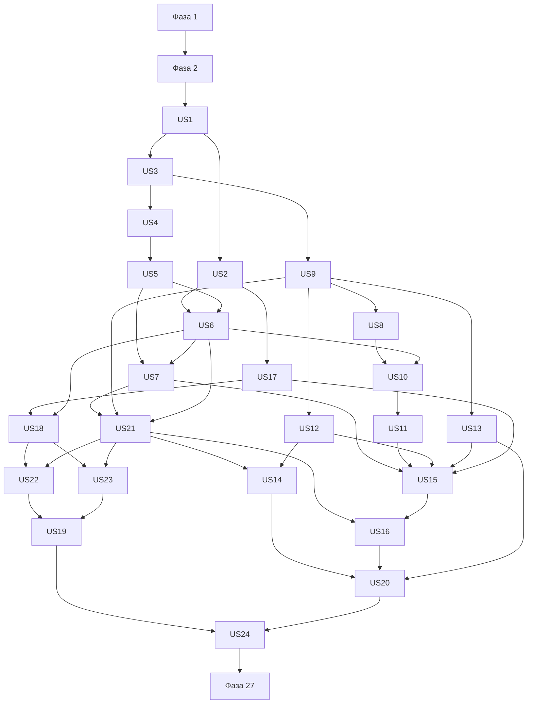

# Задачи реализации: Finance Manager

**Дата**: 2026-10-17. **Область**: всё приложение в одной спецификации.  
**Вход**: [spec.md](spec.md), [plan.md](plan.md), [research.md](research.md), [data-model.md](data-model.md), [контракты](contracts/commands.md), [CSV](contracts/csv.md), [проверка запуска](quickstart.md).  
**Обязательные правила**: [конституция](../../.specify/memory/constitution.md), особенно разделы IV–VIII.  
**Статус**: Фаза 1 завершена, T001–T009 выполнены и проверены. Фаза 2 завершена, T010–T023 выполнены и проверены. Фаза 3 завершена, T024–T034 выполнены и проверены. Фаза 4 завершена, T035–T041 выполнены и проверены; Фаза 5 завершена, T042–T047 выполнены и проверены; Фаза 6 завершена, T048–T053 выполнены и проверены; Фаза 7 завершена, T054–T060 выполнены и проверены; Фаза 8 завершена, T061–T066 выполнены и проверены; Фаза 9 завершена, T067–T072 выполнены и проверены; Фаза 10 завершена, T073–T078 выполнены и проверены; Фаза 11 завершена, T079–T084 выполнены и проверены; Фаза 12 завершена, T085–T090 выполнены и проверены; Фаза 13 завершена, T091–T096 выполнены и проверены; Фаза 14 завершена, T097–T102 выполнены и проверены; Фаза 15 завершена, T103–T108 выполнены и проверены; Фаза 16 завершена, T109–T114 выполнены и проверены; Фаза 17 завершена, T115–T120 выполнены и проверены; последующие фазы не начаты.

## Формат и правила выполнения

Каждая строка: `- [ ] TNNN [P] [USn] действие с точным путем`. `[USn]` соответствует исходной истории n, даже если порядок выполнения отличается. `[P]` разрешает параллельное написание независимых тестов внутри указанной фазы после выполнения ее зависимостей; общие migration/schema/services меняются последовательно. Числовые версии dependencies берутся из research.md, не заменяются автоматически на latest.

Тестовые задачи включены согласно конституции VIII и требованиям spec/plan: финансовая корректность, изоляция, транзакции и регрессии обязательны. Сначала описать ожидаемый контракт тестами, затем реализация, затем все проверки соответствующего инкремента должны пройти. Тестирование на настоящем PostgreSQL обязательно для FK, rollback и гонок; mock DB не является доказательством целостности.

Все новые schema-объекты включают поля и ограничения, процитированные из data-model.md. Общие ограничения: «Все финансовые таблицы содержат `workspace_id NOT NULL`»; «Связи финансовых сущностей используют составные FK `(workspace_id, entity_id)`»; «На родителях UNIQUE `(workspace_id,id)`»; «Денежные поля NUMERIC без typmod, Drizzle string mode; finite decimal string, масштаб по поддерживаемому ISO currency catalog»; «`financial_date` и даты планов — DATE»; «`created_at`, `updated_at`, `deleted_at`, audit timestamp — timestamptz UTC»; «Изменяемые объекты имеют `version` bigint для concurrency, передается строкой». UUID для application ids; тип auth ids сохраняется как у плагина. Nullable поля с `?`, enum и проверки цитируются в schema-задачах, а не выбираются при реализации.

Custom `checklists/product.md` остается reviewer-owned, 31/40; автоматически отмечать его нельзя. Этот список задач не снимает checklist gates последующей команды implement. Спецификация остается единой, отдельные spec модулей не создаются.

## Фаза 1 — Подготовка проекта

**Цель:** воспроизводимый каркас одного Next.js проекта; без предметных функций и дополнительных сервисов.

- [X] T001 Инициализировать один Next.js App Router проект и exact зависимости из research.md в `package.json`, `pnpm-lock.yaml`, `.node-version`; Node24, pnpm12.14.0, без experiment flags.
- [X] T002 Настроить strict TypeScript, server/client import boundaries, lint и форматирование в `tsconfig.json`, `eslint.config.mjs`, `.prettierrc.json`; не допускать денежных number calculations.
- [X] T003 Создать русскоязычный базовый layout и Tailwind/shadcn theme primitives в `src/app/layout.tsx`, `src/app/globals.css`, `src/components/ui/button.tsx`; light/dark и доступный focus.
- [X] T004 Настроить Vitest unit/integration и Playwright browser suites в `vitest.config.ts`, `playwright.config.ts`, `tests/integration/setup.ts`, `tests/e2e/fixtures.ts`; изолированная тестовая БД и mock mail transport.
- [X] T005 Определить server-only env schema и безопасные placeholders в `src/server/config.ts`, `.env.example`, `.gitignore`; DATABASE_URL/auth/SMTP/encryption/origin/CSV limits без реальных секретов.
- [X] T006 Настроить Drizzle PostgreSQL pool и versioned migration runner в `src/server/db/client.ts`, `drizzle.config.ts`, `src/server/db/migrate.ts`; scripts db:migrate/db:generate в `package.json`.
- [X] T007 Подготовить non-root app image, приватный db service и одноразовый migrate service в `Dockerfile`, `compose.yaml`; pin patch+digest, PostgreSQL readiness, порядок migrate→app, без публикации DB в production.
- [X] T008 Настроить Caddy TLS и live/ready Route Handlers в `deploy/Caddyfile`, `src/app/api/health/live/route.ts`, `src/app/api/health/ready/route.ts`; не выдавать секреты, проверять schema readiness.
- [X] T009 Документировать локальную настройку и команды из quickstart.md в `README.md`; установить все peer-зависимости утвержденного стека и проверить frozen-lockfile, typecheck и production build.

### Проверка Фазы 1 (2026-10-17)

- Пройдены frozen-lockfile install, peer dependencies, strict TypeScript, ESLint, форматирование и production build без настроек БД; 8 unit-тестов и 4 Playwright-теста (desktop/light, mobile/dark).
- PostgreSQL 18.6: 3 интеграционных теста — NUMERIC string, идемпотентность миграций и readiness при точной/изменённой/отсутствующей записи журнала. Команда `db:migrate` повторно выполняется успешно; `db:generate` корректно сообщает об отсутствии предметных таблиц.
- Собраны оба Docker target: app и migrate. Проверена цепочка db healthy → migrate exit 0 → app healthy → Caddy. UID приложения — 1000. Production-конфигурация сохраняет internal DB network и не публикует DB/app ports.
- Caddy config валиден; HTTPS проверен с доверенным сертификатом локальной тестовой CA, без отключения проверки TLS. Health endpoints возвращают 200; при остановке БД ready=503, live=200; после восстановления БД ready=200.
- Исправлены найденные запуском проблемы: права migration image для пользователя node, ESM/CommonJS импорт env loader в migration CLI, доступ к опубликованному loopback-порту PostgreSQL в dev override. Некорректные URL в настройках покрыты регрессионным unit-тестом и не раскрывают исходные значения.
- Проверки выполнены в отдельных Docker-проектах `finance-phase1-smoke` и `finance-phase1-tests` с временными секретами; рабочие данные не использовались. Тестовые контейнеры остановлены после проверки.
- Конституция и product checklist не изменены. Открытые пункты checklist остаются для последующего уточнения; владелец ранее разрешил продолжить Фазу 1.

## Фаза 2 — Блокирующая основа

**Цель:** общие money/calendar, auth/scope, атомарный financial pipeline и shared ledger schema. Все последующие истории зависят от этой фазы.

- [X] T010 Описать тесты scale, NaN/Infinity, exponent rejection, динамической Decimal precision, half-up и ceil в `tests/unit/money.test.ts`, включая 1,005→1,01 и 100/3→33,34; запрет скрытого округления ввода.
- [X] T011 Реализовать currency catalog и Decimal money primitives в `src/shared/money/currency.ts`, `src/shared/money/decimal.ts`; RUB scale2, ISO-коды, строки, precision с запасом для количества слагаемых, никакой финансовой арифметики number.
- [X] T012 Описать и реализовать calendar/date-only/UTC/Intl helpers с short-month anchor восстановлением в `tests/unit/calendar.test.ts`, `src/shared/calendar/calendar.ts`; месячные и годовые даты без fixed24h арифметики.
- [X] T013 Создать shared identity/workspace schema и миграцию `src/server/db/schema/identity.ts`, `src/server/db/schema/workspaces.ts`, `src/server/db/migrations/0001_identity.sql`; Better Auth user: поля «id, email, name, emailVerified, timestamps», ограничения «Уникальность email по согласованной нормализации; пароль в plugin account, не финансовой таблице»; session/account/verification: поля «По generated Better Auth schema», ограничения «Конфиденциальные сохраняемые токены шифруются, session secrets не выдаются финансовым DTO; политика Better Auth не заменяется самописными паролями»; user_profile: поля «user_id, locale, timezone, version», ограничения «1:1 user; основные preference поля не меняют email; version bigint NOT NULL DEFAULT 1, expectedVersion обязателен для изменения, успешное изменение увеличивает version на 1»; organization/member/invitation: поля «По Organization Plugin schema», ограничения «Family membership здесь; member UNIQUE(organization_id,user_id); роли только owner/member, никаких admin/multi-role»; workspace: поля «id, kind personal/family, personal_owner_id?, organization_id?, family_owner_id?, timezone?, deleted_at?, deleted_by?, version», ограничения «personal: owner NOT NULL, organization NULL; family: organization/owner/timezone NOT NULL. Partial UNIQUE personal_owner_id при kind personal; UNIQUE organization_id; version bigint NOT NULL DEFAULT 1, rename/timezone/confirmed owner transfer/soft-delete проверяют expectedVersion и увеличивают version на 1 в том же tx».
- [X] T014 Создать shared account/category schema и миграцию `src/server/db/schema/accounts.ts`, `src/server/db/schema/categories.ts`, `src/server/db/migrations/0002_accounts.sql`; financial_account: поля «id, workspace_id, name, type, currency, opening_balance, balance_projection, description?, archived_at?, version», ограничения «Ровно один workspace и одна валюта; изменение currency/workspace не предоставляется. Opening balance допускает минус. Изменение opening сохраняет revision и влияет только на остатки»; category: поля «id, workspace_id, name, kind income/expense, archived_at?, version», ограничения «Операция использует категорию соответствующего типа своего workspace. Архивация не удаляет FK; FK ON DELETE RESTRICT».
- [X] T015 Создать ledger/revisions/audit/receipt schema и миграцию `src/server/db/schema/ledger.ts`, `src/server/db/migrations/0003_ledger.sql`; financial_action: поля «id, creator_id, kind income/expense/transfer, current_revision, status active/deleted, version, created_at», ограничения «Системная связь действия; не является финансовой записью без workspace. Не выдавать напрямую клиенту»; action_revision: поля «action_id, revision_no, actor_id, happened_at, reason?, status», ограничения «UNIQUE(action,revision); immutable. Прежние versions сохраняются. Содержимое scoped legs хранится отдельно»; ledger_leg: поля «id, workspace_id, action_id, revision_no, account_id, role income/expense/transfer_out/transfer_in, amount, currency, financial_date, category_id?, private_description?», ограничения «FK workspace/account и workspace/category. amount >0; category обязательна только income/expense. Валюта равна account.currency. UNIQUE(action,revision,role)»; transfer_detail: поля «action_id, revision_no, source_leg_id, destination_leg_id, rate_numerator, rate_denominator, rate_decimal, rate_direction», ограничения «Ровно две legs, оба amounts >0, разные accounts; для одной currency суммы равны. Numerator=списание, denominator=зачисление — точное представление курса»; scoped_audit_event: поля «id, workspace_id, object_type/id, actor_id, occurred_at, revision_no, before_scope, after_scope, kind», ограничения «Неизменяемый аудит только своих данных; события межпространственного действия создаются отдельно для обеих сторон»; command_receipt: поля «actor_id, operation_key, request_hash, status, action_id?, result_ref?, created_at», ограничения «UNIQUE(actor,operation_key); тот же key с другим payload — conflict. Result заново scope-filtered при чтении, membership проверяется даже на retry».
- [X] T016 Настроить Better Auth, Organization Plugin и tx-aware domain adapter в `src/server/auth/auth.ts`, `src/server/auth/organization-adapter.ts`, `src/app/api/auth/[...all]/route.ts`; роли owner/member, disableOrganizationDeletion:true, запрет role/org bypass, без HTTP внутри db.transaction.
- [X] T017 Реализовать current-session/workspace authorization facade в `src/server/security/access.ts`; default deny, personal ownership, current membership, readonly deleted owner; проверка raw auth endpoints без блокировки signup/reset целиком.
- [X] T018 Реализовать workspace command envelope, Zod errors и idempotency transaction executor в `src/shared/contracts/commands.ts`, `src/modules/ledger/application/transaction.ts`; порядок workspace→membership→action→account по id, request hash, expectedVersion, stale negative confirmation. Identity/signup/signin/reset и собственный профиль не направлять в финансовый executor; createFamily выполняет session-only создание scope по contracts/commands.md.
- [X] T019 Реализовать server-only encryption и SMTP/mock delivery adapter в `src/server/security/encryption.ts`, `src/server/mail/transport.ts`; пароль только Better Auth, токены и ссылки не логируются.
- [X] T020 Создать security counter schema и миграцию в `src/server/db/schema/auth-rate-limits.ts`, `src/server/db/migrations/0004_auth_rate_limits.sql`, конфигурацию в `src/server/config.ts`; auth_rate_bucket: поля «id, action, subject_hash, window_started_at, attempt_timestamps, expires_at»; атомарные counters на IP/email/owner без сырых секретов, без Redis; defaults сроков/лимитов из ФТ-066.
- [X] T021 Реализовать guards в `src/server/auth/rate-limits.ts` и интеграцию `src/server/auth/auth.ts`, `src/server/auth/organization-adapter.ts`; приглашение7суток/reset1час одноразово, login5fail/15min/IP+email, reset3/email+10/IP/15min, invites10/hour/owner+1/min/recipient. Тесты boundary/expiry/resend/concurrency/direct endpoint/proxy IP в `tests/integration/auth-limits.test.ts`; values server-configurable, reset не раскрывает зарегистрированную почту.
- [X] T022 Настроить безопасные scoped DTO, correlation/error logging и consistent read snapshot в `src/server/security/projection.ts`, `src/server/security/logging.ts`, `src/server/db/read-snapshot.ts`; no-store financial responses, никакого shared cross-user cache.
- [X] T023 Добавить инфраструктурные integration gates в `tests/integration/foundation.test.ts`: rollback тестовой транзакции через tx-aware адаптер, composite FK, NUMERIC string, owner deferred trigger на подготовленных fixtures и запрет прямого plugin bypass. Заблокировать переход к историям до успеха этих проверок и typecheck/build. Полный signup rollback проверяется в US1, createFamily/owner transfer rollback — US2, двухсторонний transfer rollback — US6; не требовать от foundation еще не реализованных application services.

### Проверка Фазы 2 (17.10.2026)

- 22 unit, 22 integration на отдельной PostgreSQL 18.6 и 6 Playwright-проверок прошли. Проверены precision/scale/округление, календарные границы, изоляция scope, composite FK, deferred owner/ledger constraints, неизменяемость истории, конкурентная идемпотентность, версии, подтверждения, snapshot и ограничения auth.
- Tx-aware адаптер проверен откатом native Organization API и callback provisioning внутри транзакции регистрации. Полные пользовательские сценарии signup/createFamily/transfer остаются в соответствующих последующих фазах.
- `typecheck`, `lint`, `format:check`, production build и Docker build app/migrate прошли; frozen lockfile использован при сборке. `db:generate` не обнаружил изменений схемы.
- Чистое проверочное Compose-окружение применило все пять миграций. App работает с UID 1000, app/db/Caddy healthy; readiness через проверенный локальный TLS возвращает ready, конфигурация Caddy валидна.
- HTTPS signup/session проверены на временном пользователе: Secure/HttpOnly cookie сохраняет авторизацию, JSON не выдаёт session token, ответы no-store. Реальные письма не отправлялись.
- После переполнения диска Docker восстановлен без удаления volumes. Открытые пункты requirements-quality checklist не отмечались; продолжение Фазы 2 было явно разрешено пользователем. Конституция не изменялась.

## Фаза 3 — US1: Регистрация и личное пространство (P1)

**Цель:** история 1 из spec.md. **Покрытие:** ФТ-001–005; КУ-001.

**Зависимости:** фаза 2.

**Независимая приемка:** Зарегистрировать нового пользователя и проверить доступные пространства. Дополнительно: повторная почта, атомарный signup personal, sign-in/out/reset, профиль и отсутствие данных без session. Подготовленные fixtures соответствуют зависимостям и не требуют завершения более поздних историй.

### Проверки контракта и инвариантов

- [X] T024 [P] [US1] Написать Vitest unit/contract cases (повторная почта, атомарный signup personal, sign-in/out/reset, профиль и отсутствие данных без session) в `tests/unit/registration.test.ts`; использовать contracts/commands.md, ФТ-001–005; КУ-001 и точные Decimal строки.
- [X] T025 [P] [US1] Написать PostgreSQL integration и Playwright сценарии истории 1 в `tests/integration/registration.test.ts`, `tests/e2e/registration.spec.ts`; включить failure/permission cases и все сценарии приемки US1. Явно проверить полный rollback signup при ошибке provisioning personal workspace, отсутствие пользователя без пространства и stale profile version conflict.

### Модель, application service и интерфейс

- [X] T026 [US1] Определить/уточнить Zod DTO и правила истории в `src/modules/identity/application/registration-input.ts`, `src/modules/identity/domain/registration.ts`, переиспользуя shared schemas из фазы2; поля и инварианты по ФТ-001–005; КУ-001, без параллельных money/account/goal tables.
- [X] T027 [US1] Реализовать signup provisioning пользователя и personal workspace одним отдельным tx в `src/modules/identity/application/registration.ts`, `src/modules/identity/infrastructure/registration-repository.ts`; пароль и login/logout/reset через Better Auth без финансового executor или предварительного workspace. Profile name/locale/timezone изменять только собственной session с expectedVersion, атомарным увеличением user_profile.version; смены почты нет.
- [X] T028 [US1] Подключить registration transport в `src/modules/identity/presentation/registration-actions.ts` и форму `src/app/(auth)/register/page.tsx`; русские подписи, React Hook Form/Zod, loading/error, focus; перед регистрацией не требовать session/workspace, успех только после personal provisioning.
- [X] T029 [US1] Подключить вход через Better Auth в `src/app/(auth)/login/page.tsx`, `src/modules/identity/presentation/login-actions.ts`; ошибки без раскрытия учетных данных, вход без предварительной session, переход на personal dashboard после успеха.
- [X] T030 [US1] Добавить запрос восстановления пароля в `src/app/(auth)/forgot-password/page.tsx`, `src/modules/identity/presentation/password-recovery-actions.ts`; Better Auth mail flow, понятное подтверждение без раскрытия существования чужой почты.
- [X] T031 [US1] Добавить установку нового пароля в `src/app/(auth)/reset-password/page.tsx`, `src/modules/identity/presentation/password-reset-actions.ts`; проверка reset token средствами Better Auth, expired/invalid token и безопасный переход ко входу.
- [X] T032 [US1] Добавить редактирование собственного профиля в `src/app/(finance)/profile/page.tsx`, `src/modules/identity/presentation/profile-actions.ts`; name/locale/timezone, session и expectedVersion, сохранение ввода при conflict, без требования активного workspace.
- [X] T033 [US1] Добавить выход в `src/modules/identity/presentation/logout-button.tsx`, `src/modules/identity/presentation/logout-actions.ts` и подключить к `src/app/(finance)/layout.tsx`; после signout финансовые данные недоступны, secret/session не выдаются клиенту.
- [X] T034 [US1] Запустить и довести до успеха созданные тесты `tests/unit/registration.test.ts`, `tests/integration/registration.test.ts`, `tests/e2e/registration.spec.ts`, typecheck и затронутые регрессии; результаты/команды записать в `specs/001-finance-manager/validation/us01.md`, без секретов и финансовых payload. В E2E явно пройти register/login/logout/forgot-password/reset-password/profile через доступные интерфейсы; token expired и profile stale version должны иметь ожидаемые состояния.

**Контрольная точка US1:** все сценарии истории и соответствующие инварианты пройдены; результат не означает готовность других историй.

### Проверка Фазы 3 (17.10.2026)

- T024–T034 завершены. Все 30 unit, 27 PostgreSQL integration и 12 Playwright-проверок прошли; typecheck, lint, форматирование и production build успешны.
- Проверены атомарный signup/provisioning rollback, повторная почта и конкурентная регистрация, приватность personal при семейном членстве, вход/выход/reset и версии профиля. В браузере пройден весь auth/profile lifecycle, expired/invalid reset, stale profile и сохранение несохранённого ввода; desktop/light и mobile/dark.
- Подробные команды, результаты и ограничения: [validation/us01.md](validation/us01.md). Семейные и финансовые интерфейсы последующих историй не реализовывались.
- Конституция и чек-листы не изменены; пользователь разрешил продолжить при product checklist 31/40. Extension hooks отсутствуют.

## Фаза 4 — US2: Создание семьи и управление участниками (P1)

**Цель:** история 2 из spec.md. **Покрытие:** ФТ-006–011,014; КУ-002.

**Зависимости:** фаза 2 и US1.

**Независимая приемка:** Создать семью и пройти жизненный цикл приглашения двумя пользователями. Дополнительно: invite accept/reject/cancel, владелец один, member role, races transfer/delete, readonly export deleted family. Подготовленные fixtures соответствуют зависимостям и не требуют завершения более поздних историй.

### Проверки контракта и инвариантов

- [X] T035 [P] [US2] Написать Vitest unit/contract cases (invite accept/reject/cancel, владелец один, member role, races transfer/delete, readonly export deleted family) в `tests/unit/family.test.ts`; использовать contracts/commands.md, ФТ-006–011,014; КУ-002 и точные Decimal строки.
- [X] T036 [P] [US2] Написать PostgreSQL integration и Playwright сценарии истории 2 в `tests/integration/family.test.ts`, `tests/e2e/family.spec.ts`; включить failure/permission cases и все сценарии приемки US2. Явно проверить rollback полного createFamily и подтвержденного owner transfer, а также atomic expectedVersion→workspace.version+1 для rename/timezone/transfer/delete.

### Модель, application service и интерфейс

- [X] T037 [US2] Создать модель/миграцию в `src/server/db/schema/family.ts`, `src/server/db/migrations/us02_family.sql` и Zod input в `src/modules/workspaces/application/family-input.ts`; ownership_offer: поля «id, workspace_id, initiator_id, recipient_id, status pending/accepted/cancelled, workspace_version, timestamps», ограничения «Получатель текущий family member. Принятие меняет owner/member в одном tx. Pending offers с устаревшей owner version не принимаются». Сохранить общие scoped FK/date/money ограничения.
- [X] T038 [US2] Реализовать Create family, invite/member lifecycle, confirmed owner transfer и soft-delete единственным owner; отмена invites, бывшему owner только history/export в `src/modules/workspaces/application/family.ts` и `src/modules/workspaces/infrastructure/family-repository.ts`; authorization, audit/version и shared tx executor обязательны; domain расчеты отдельно от repository. Rename/timezone/confirmed owner transfer/soft-delete проверяют expectedVersion и увеличивают workspace.version в том же tx; stale ownership_offer не принимается.
- [X] T039 [US2] Подключить server transport в `src/modules/workspaces/presentation/family-actions.ts` и UI в `src/app/(finance)/families/page.tsx`; React Hook Form/Zod, русские подписи, loading/error, accessible focus, no money math в React, explicit workspace и no-store.
- [X] T040 [US2] Добавить минимальный P1 encoder/history export deleted family в `src/modules/data-exchange/application/export-history.ts`, `src/app/api/workspaces/[workspaceId]/csv/export/route.ts`; только бывший owner, contract CSV quoting/injection/privacy; общий экспорт расширяется US22, не ждать P2 для ФТ-011. В межпространственных строках оставить counterparty_account/currency/amount и rate_numerator/denominator пустыми; проверить это на deleted-family fixture.
- [X] T041 [US2] Запустить и довести до успеха созданные тесты `tests/unit/family.test.ts`, `tests/integration/family.test.ts`, `tests/e2e/family.spec.ts`, typecheck и затронутые регрессии; результаты/команды записать в `specs/001-finance-manager/validation/us02.md`, без секретов и финансовых payload.

**Контрольная точка US2:** все сценарии истории и соответствующие инварианты пройдены; результат не означает готовность других историй.

### Проверка Фазы 4 (17.10.2026)

- Пройдены 40 unit, 33 PostgreSQL integration и 16 Playwright-проверок полного набора, typecheck, lint, форматирование и production build.
- Проверены атомарный createFamily/owner transfer rollback, invitation lifecycle, версии, конкурентные accept/delete и transfer/remove, запрет owner leave, отзыв доступа и приватность deleted-family CSV на FX fixture.
- Реализованы семьи, предложения передачи владения, мягкое удаление и сохранённая история/экспорт. Следующие истории не реализовывались. Миграция `us02_family.sql` зарегистрирована; рабочая БД не изменялась.
- Подробный отчёт и команды — [validation/us02.md](validation/us02.md). Пользователь разрешил продолжить с product checklist 31/40; чеклисты и конституция не изменены. Extension hooks отсутствуют.

## Фаза 5 — US3: Создание и архивация счета (P1)

**Цель:** история 3 из spec.md. **Покрытие:** ФТ-015–018; КУ-003.

**Зависимости:** фаза 2 и US1.

**Независимая приемка:** Создать банковский счет с начальным балансом 100 000 RUB. Дополнительно: opening100000 без income, zero/negative, archive history и correction90000→107000 с audit. Подготовленные fixtures соответствуют зависимостям и не требуют завершения более поздних историй.

### Проверки контракта и инвариантов

- [X] T042 [P] [US3] Написать Vitest unit/contract cases (opening100000 без income, zero/negative, archive history и correction90000→107000 с audit) в `tests/unit/accounts.test.ts`; использовать contracts/commands.md, ФТ-015–018; КУ-003 и точные Decimal строки.
- [X] T043 [P] [US3] Написать PostgreSQL integration и Playwright сценарии истории 3 в `tests/integration/accounts.test.ts`, `tests/e2e/accounts.spec.ts`; включить failure/permission cases и все сценарии приемки US3.

### Модель, application service и интерфейс

- [X] T044 [US3] Определить/уточнить Zod DTO и правила истории в `src/modules/ledger/application/accounts-input.ts`, `src/modules/ledger/domain/accounts.ts`, переиспользуя shared schemas из фазы2; поля и инварианты по ФТ-015–018; КУ-003, без параллельных money/account/goal tables.
- [X] T045 [US3] Реализовать Create/update/archive account и correction opening с confirmation, audit и Decimal balance projection в `src/modules/ledger/application/accounts.ts` и `src/modules/ledger/infrastructure/accounts-repository.ts`; authorization, audit/version и shared tx executor обязательны; domain расчеты отдельно от repository.
- [X] T046 [US3] Подключить server transport в `src/modules/ledger/presentation/accounts-actions.ts` и UI в `src/app/(finance)/w/[workspaceId]/accounts/page.tsx`; React Hook Form/Zod, русские подписи, loading/error, accessible focus, no money math в React, explicit workspace и no-store.
- [X] T047 [US3] Запустить и довести до успеха созданные тесты `tests/unit/accounts.test.ts`, `tests/integration/accounts.test.ts`, `tests/e2e/accounts.spec.ts`, typecheck и затронутые регрессии; результаты/команды записать в `specs/001-finance-manager/validation/us03.md`, без секретов и финансовых payload.

### Проверка Фазы 5 (17.10.2026)

- T042–T047 выполнены: счета, scoped queries/history, correction opening с audit/подтверждением, archive без потери средств, русскоязычный интерфейс.
- Полные наборы: 46 unit, 38 PostgreSQL integration, 20 Playwright; typecheck/lint/format и production build прошли.
- Подробные результаты, команды и границы проверки: [validation/us03.md](validation/us03.md). Новых миграций нет. Конституция и reviewer-owned checklists не изменены; пользователь разрешил продолжение при product checklist 31/40.

**Контрольная точка US3:** все сценарии истории и соответствующие инварианты пройдены; результат не означает готовность других историй.

## Фаза 6 — US4: Добавление дохода (P1)

**Цель:** история 4 из spec.md. **Покрытие:** ФТ-021–022,029; КУ-003.

**Зависимости:** фаза 2 и US3.

**Независимая приемка:** Добавить доход 20 000 RUB на счет с остатком 100 000 RUB. Дополнительно: 100000+20000=120000, repeat key один эффект, category income/scope/currency. Подготовленные fixtures соответствуют зависимостям и не требуют завершения более поздних историй.

### Проверки контракта и инвариантов

- [X] T048 [P] [US4] Написать Vitest unit/contract cases (100000+20000=120000, repeat key один эффект, category income/scope/currency) в `tests/unit/income.test.ts`; использовать contracts/commands.md, ФТ-021–022,029; КУ-003 и точные Decimal строки.
- [X] T049 [P] [US4] Написать PostgreSQL integration и Playwright сценарии истории 4 в `tests/integration/income.test.ts`, `tests/e2e/income.spec.ts`; включить failure/permission cases и все сценарии приемки US4.

### Модель, application service и интерфейс

- [X] T050 [US4] Определить/уточнить Zod DTO и правила истории в `src/modules/ledger/application/income-input.ts`, `src/modules/ledger/domain/income.ts`, переиспользуя shared schemas из фазы2; поля и инварианты по ФТ-021–022,029; КУ-003, без параллельных money/account/goal tables.
- [X] T051 [US4] Реализовать Create income с первичным выбором/созданием income category, revision, audit и receipt одним tx в `src/modules/ledger/application/income.ts` и `src/modules/ledger/infrastructure/income-repository.ts`; authorization, audit/version и shared tx executor обязательны; domain расчеты отдельно от repository.
- [X] T052 [US4] Подключить server transport в `src/modules/ledger/presentation/income-actions.ts` и UI в `src/modules/ledger/presentation/income-form.tsx`; React Hook Form/Zod, русские подписи, loading/error, accessible focus, no money math в React, explicit workspace и no-store.
- [X] T053 [US4] Запустить и довести до успеха созданные тесты `tests/unit/income.test.ts`, `tests/integration/income.test.ts`, `tests/e2e/income.spec.ts`, typecheck и затронутые регрессии; результаты/команды записать в `specs/001-finance-manager/validation/us04.md`, без секретов и финансовых payload.

### Проверка Фазы 6 (17.10.2026)

- T048–T053 выполнены: доход и явное создание/выбор income category, immutable revision/leg, audit, balance/version и receipt одним tx; защищённая форма на странице счетов, месячный доход отдельно по валютам.
- 50/50 unit, 43/43 PostgreSQL integration; после объединения read snapshot — 10/10 затронутых integration. Финальный Playwright — 22/22, включая потерю ответа после commit и retry без второго дохода, desktop/light и mobile/dark. TypeScript, ESLint, Prettier и чистая production-сборка прошли.
- Подробные команды и инварианты: [validation/us04.md](validation/us04.md). Новых migrations нет. Checklist markers и конституция не изменены; продолжение с product checklist 31/40 разрешено пользователем. Hooks отсутствуют.

**Контрольная точка US4:** все сценарии истории и соответствующие инварианты пройдены; результат не означает готовность других историй.

## Фаза 7 — US5: Добавление расхода и категории (P1)

**Цель:** история 5 из spec.md. **Покрытие:** ФТ-019–022; КУ-003.

**Зависимости:** фаза 2 и US4.

**Независимая приемка:** Создать категорию «Продукты» и расход 3 000 RUB. Дополнительно: расход3000→117000, категории CRUD/archive, минус1500при1000 warning, decline/confirm/stale. Подготовленные fixtures соответствуют зависимостям и не требуют завершения более поздних историй.

### Проверки контракта и инвариантов

- [X] T054 [P] [US5] Написать Vitest unit/contract cases (расход3000→117000, категории CRUD/archive, минус1500при1000 warning, decline/confirm/stale) в `tests/unit/expenses.test.ts`; использовать contracts/commands.md, ФТ-019–022; КУ-003 и точные Decimal строки.
- [X] T055 [P] [US5] Написать PostgreSQL integration и Playwright сценарии истории 5 в `tests/integration/expenses.test.ts`, `tests/e2e/expenses.spec.ts`; включить failure/permission cases и все сценарии приемки US5.

### Модель, application service и интерфейс

- [X] T056 [US5] Определить/уточнить Zod DTO и правила истории в `src/modules/categories/application/expenses-input.ts`, `src/modules/categories/domain/expenses.ts`, переиспользуя shared schemas из фазы2; поля и инварианты по ФТ-019–022; КУ-003, без параллельных money/account/goal tables.
- [X] T057 [US5] Реализовать Expense command через ledger executor; category management обоих типов, archive сохраняет ссылки; отдельное подтверждение минуса в `src/modules/categories/application/expenses.ts` и `src/modules/categories/infrastructure/expenses-repository.ts`; authorization, audit/version и shared tx executor обязательны; domain расчеты отдельно от repository.
- [X] T058 [US5] Подключить server transport в `src/modules/categories/presentation/expenses-actions.ts` и UI в `src/modules/categories/presentation/category-manager.tsx`; React Hook Form/Zod, русские подписи, loading/error, accessible focus, no money math в React, explicit workspace и no-store.
- [X] T059 [US5] Реализовать expense application/transport в `src/modules/ledger/application/expenses.ts`, `src/modules/ledger/presentation/expense-actions.ts` и форму в `src/modules/ledger/presentation/expense-form.tsx`; добавить серверные category CRUD actions в `src/modules/categories/presentation/category-actions.ts`; income category helper US4 переиспользовать, category archive не удаляет history.
- [X] T060 [US5] Запустить и довести до успеха созданные тесты `tests/unit/expenses.test.ts`, `tests/integration/expenses.test.ts`, `tests/e2e/expenses.spec.ts`, typecheck и затронутые регрессии; результаты/команды записать в `specs/001-finance-manager/validation/us05.md`, без секретов и финансовых payload.

**Контрольная точка US5:** все сценарии истории и соответствующие инварианты пройдены; результат не означает готовность других историй.

### Проверка Фазы 7 (17.10.2026)

- T054–T060 завершены: расход через общий ledger executor, категории income/expense create/update/archive с audit/version, отдельное отрицательное подтверждение, общая форма дохода/расхода и один snapshot страницы. Новых таблиц/миграций/dependencies нет.
- Unit 53/53, PostgreSQL integration 50/50 (7 US5), Playwright 26/26 последовательно (desktop/light, mobile/dark), typecheck/lint/format и production build пройдены. В параллельном dev-прогоне остаётся нестабильность готовности прежних family/profile/logout страниц; подробности и команды — [validation/us05.md](validation/us05.md).
- Checklist product 31/40 оставлен неизменным; продолжение разрешено пользователем. Конституция не изменена; extension hooks отсутствуют. Последующие фазы не начаты.

## Фаза 8 — US6: Перевод между своими счетами (P1)

**Цель:** история 6 из spec.md. **Покрытие:** ФТ-023–025,029; КУ-004.

**Зависимости:** фаза 2 и US2, US3, US5.

**Независимая приемка:** Перевести 10 000 RUB между двумя счетами одного пространства. Дополнительно: 50000/20000→40000/30000, rollback после первой leg, повтор, cross-space privacy/permissions после исключения. Подготовленные fixtures соответствуют зависимостям и не требуют завершения более поздних историй.

### Проверки контракта и инвариантов

- [X] T061 [P] [US6] Написать Vitest unit/contract cases (50000/20000→40000/30000, rollback после первой leg, повтор, cross-space privacy/permissions после исключения) в `tests/unit/transfers.test.ts`; использовать contracts/commands.md, ФТ-023–025,029; КУ-004 и точные Decimal строки.
- [X] T062 [P] [US6] Написать PostgreSQL integration и Playwright сценарии истории 6 в `tests/integration/transfers.test.ts`, `tests/e2e/transfers.spec.ts`; включить failure/permission cases и все сценарии приемки US6. Явно проверить полный rollback двухстороннего application transfer при сбое после первой leg.

### Модель, application service и интерфейс

- [X] T063 [US6] Определить/уточнить Zod DTO и правила истории в `src/modules/ledger/application/transfers-input.ts`, `src/modules/ledger/domain/transfers.ts`, переиспользуя shared schemas из фазы2; поля и инварианты по ФТ-023–025,029; КУ-004, без параллельных money/account/goal tables.
- [X] T064 [US6] Реализовать Same-currency transfer и personal↔family с обеими legs одним tx; derived rate pair, strict actor обеих сторон, безопасный scoped DTO в `src/modules/ledger/application/transfers.ts` и `src/modules/ledger/infrastructure/transfers-repository.ts`; authorization, audit/version и shared tx executor обязательны; domain расчеты отдельно от repository.
- [X] T065 [US6] Подключить server transport в `src/modules/ledger/presentation/transfers-actions.ts` и UI в `src/modules/ledger/presentation/transfer-form.tsx`; React Hook Form/Zod, русские подписи, loading/error, accessible focus, no money math в React, explicit workspace и no-store.
- [X] T066 [US6] Запустить и довести до успеха созданные тесты `tests/unit/transfers.test.ts`, `tests/integration/transfers.test.ts`, `tests/e2e/transfers.spec.ts`, typecheck и затронутые регрессии; результаты/команды записать в `specs/001-finance-manager/validation/us06.md`, без секретов и финансовых payload.

**Контрольная точка US6:** все сценарии истории и соответствующие инварианты пройдены; результат не означает готовность других историй.

### Проверка Фазы 8 (17.10.2026)

- T061–T066 выполнены. Same-currency и personal↔family переводы используют shared ledger schema/executor: обе legs, баланс/версии, scoped audit и receipt атомарны. Семья видит только собственную сторону. Новых таблиц и dependencies нет.
- Полный набор: 56 unit, 56 PostgreSQL integration и 30 Playwright проверок; TypeScript, ESLint, Prettier и чистый production build пройдены. US6 включает 3 unit, 6 integration и 4 browser проверки (desktop/light, mobile/dark).
- Проверены rollback после debit leg/balance, concurrent retry/conflict, встречные переводы, stale negative confirmation, cross-space privacy и отзыв доступа, включая гонку remove/write. Browser проверяет потерю ответа после commit и открытую форму после исключения. Подробности — [validation/us06.md](validation/us06.md).
- Edit/delete истории остаются в US21, конвертация — US23. Checklist и конституция не изменялись; пользователь разрешил текущий checklist gate. Extensions hooks отсутствуют. Последующие фазы не выполнялись.

## Фаза 9 — US7: Месячный бюджет (P1)

**Цель:** история 7 из spec.md. **Покрытие:** ФТ-030–032; КУ-005.

**Зависимости:** фаза 2 и US5, US6.

**Независимая приемка:** Составить бюджет по приведенному в требованиях примеру. Дополнительно: plan200000/115000→85000; продукты33000limit30000→−3000/110%, zero/no-limit, transfers excluded. Подготовленные fixtures соответствуют зависимостям и не требуют завершения более поздних историй.

### Проверки контракта и инвариантов

- [X] T067 [P] [US7] Написать Vitest unit/contract cases (plan200000/115000→85000; продукты33000limit30000→−3000/110%, zero/no-limit, transfers excluded) в `tests/unit/monthly-budget.test.ts`; использовать contracts/commands.md, ФТ-030–032; КУ-005 и точные Decimal строки.
- [X] T068 [P] [US7] Написать PostgreSQL integration и Playwright сценарии истории 7 в `tests/integration/monthly-budget.test.ts`, `tests/e2e/monthly-budget.spec.ts`; включить failure/permission cases и все сценарии приемки US7.

### Модель, application service и интерфейс

- [X] T069 [US7] Создать модель/миграцию в `src/server/db/schema/monthly-budget.ts`, `src/server/db/migrations/us07_monthly-budget.sql` и Zod input в `src/modules/budgeting/application/monthly-budget-input.ts`; monthly_budget: поля «id, workspace_id, month (первое число), currency, planned_income, version», ограничения «UNIQUE(workspace,month,currency); plan >=0»; budget_limit: поля «workspace_id, budget_id, category_id, amount», ограничения «UNIQUE(budget,category), amount >=0, expense category; FK budget/category одного workspace». Сохранить общие scoped FK/date/money ограничения.
- [X] T070 [US7] Реализовать Budget save/query планов и Decimal fact всех расходов месяца, без начальных остатков и переводов в `src/modules/budgeting/application/monthly-budget.ts` и `src/modules/budgeting/infrastructure/monthly-budget-repository.ts`; authorization, audit/version и shared tx executor обязательны; domain расчеты отдельно от repository.
- [X] T071 [US7] Подключить server transport в `src/modules/budgeting/presentation/monthly-budget-actions.ts` и UI в `src/app/(finance)/w/[workspaceId]/budget/page.tsx`; React Hook Form/Zod, русские подписи, loading/error, accessible focus, no money math в React, explicit workspace и no-store.
- [X] T072 [US7] Запустить и довести до успеха созданные тесты `tests/unit/monthly-budget.test.ts`, `tests/integration/monthly-budget.test.ts`, `tests/e2e/monthly-budget.spec.ts`, typecheck и затронутые регрессии; результаты/команды записать в `specs/001-finance-manager/validation/us07.md`, без секретов и финансовых payload.

**Контрольная точка US7:** все сценарии истории и соответствующие инварианты пройдены; результат не означает готовность других историй.

### Проверка Фазы 9 (17.10.2026)

- T067–T072 выполнены. Полные unit 59/59 и PostgreSQL integration 59/59; Playwright US7 2/2 (desktop/light, mobile/dark). Typecheck, lint, format и production build прошли; db:generate не обнаружил новых изменений.
- План и факт разделены; Decimal, версии, audit, idempotency, rollback, семейные права и изоляция проверены. Подробности и команды: [validation/us07.md](validation/us07.md).
- Product checklist и конституция не изменялись; запуск разрешён пользователем. Последующие фазы не выполнялись.

## Фаза 10 — US9: Резервный фонд на 12 месяцев (P1)

**Цель:** история 9 из spec.md. **Покрытие:** ФТ-033–039; КУ-006–009.

**Зависимости:** фаза 2 и US3.

**Независимая приемка:** Связать резерв со счетом 220 000 RUB при платеже 50 000 RUB. Дополнительно: reserve50000×12=600000;220000→380000/36,67%/4,4; zero и deficit с null, reached обратим. Подготовленные fixtures соответствуют зависимостям и не требуют завершения более поздних историй.

### Проверки контракта и инвариантов

- [X] T073 [P] [US9] Написать Vitest unit/contract cases (reserve50000×12=600000;220000→380000/36,67%/4,4; zero и deficit с null, reached обратим) в `tests/unit/reserve.test.ts`; использовать contracts/commands.md, ФТ-033–039; КУ-006–009 и точные Decimal строки.
- [X] T074 [P] [US9] Написать PostgreSQL integration и Playwright сценарии истории 9 в `tests/integration/reserve.test.ts`, `tests/e2e/reserve.spec.ts`; включить failure/permission cases и все сценарии приемки US9.

### Модель, application service и интерфейс

- [X] T075 [US9] Создать модель/миграцию в `src/server/db/schema/reserve.ts`, `src/server/db/migrations/us09_reserve.sql` и Zod input в `src/modules/goals/application/reserve-input.ts`; goal: поля «id, workspace_id, name, description?, type ordinary/reserve, currency, account_id, ordinary_target?, target_date?, archived_at?, version», ограничения «UNIQUE(workspace,account_id) WHERE archived_at IS NULL. ordinary target >0; reserve target вычисляется. Goal/account currency совпадает»; reserve_settings: поля «workspace_id, goal_id, monthly_amount, coverage_months, linked_obligation_id?», ограничения «goal reserve, months integer >0, amount >=0; связь только с monthly N=1 того же workspace/currency». На этом P1 этапе linked_obligation_id всегда NULL: FK к будущей obligation таблице добавляется в US14, связь до P2 недоступна. Сохранить общие scoped FK/date/money ограничения.
- [X] T076 [US9] Реализовать Общее создание/редактирование/архивация обычной цели и reserve subtype; Decimal progress/remaining/coverage, no-obligation и deficit в `src/modules/goals/application/reserve.ts` и `src/modules/goals/infrastructure/reserve-repository.ts`; authorization, audit/version и shared tx executor обязательны; domain расчеты отдельно от repository.
- [X] T077 [US9] Подключить server transport в `src/modules/goals/presentation/reserve-actions.ts` и UI в `src/app/(finance)/w/[workspaceId]/goals/page.tsx`; React Hook Form/Zod, русские подписи, loading/error, accessible focus, no money math в React, explicit workspace и no-store.
- [X] T078 [US9] Запустить и довести до успеха созданные тесты `tests/unit/reserve.test.ts`, `tests/integration/reserve.test.ts`, `tests/e2e/reserve.spec.ts`, typecheck и затронутые регрессии; результаты/команды записать в `specs/001-finance-manager/validation/us09.md`, без секретов и финансовых payload.

**Контрольная точка US9:** все сценарии истории и соответствующие инварианты пройдены; результат не означает готовность других историй.

### Проверка Фазы 10 (17.10.2026)

- T073–T078 выполнены. Полные unit65/65 и PostgreSQL integration64/64; Playwright US9+accounts6/6 (desktop/light, mobile/dark). Typecheck, lint, format и production build прошли; db:generate не обнаружил новых изменений.
- Общие ordinary/reserve цели, Decimal progress/coverage, zero/deficit, обратимое достижение, version/audit/idempotency, rollback, семейные права и изоляция проверены. Отчёт: [validation/us09.md](validation/us09.md).
- Checklist markers и конституция не изменялись; gate разрешён пользователем. Связь с обязательствами остаётся недоступной до US14. Последующие фазы не выполнялись.

## Фаза 11 — US8: Накопительный счет для ипотечной подушки (P1)

**Цель:** история 8 из spec.md. **Покрытие:** ФТ-015,034–035; КУ-006.

**Зависимости:** фаза 2 и US3, US9.

**Независимая приемка:** Создать накопительный счет с остатком 220 000 RUB. Дополнительно: savings220000 counted once, счет недоступен второй active goal, история до цели. Подготовленные fixtures соответствуют зависимостям и не требуют завершения более поздних историй.

### Проверки контракта и инвариантов

- [X] T079 [P] [US8] Написать Vitest unit/contract cases (savings220000 counted once, счет недоступен второй active goal, история до цели) в `tests/unit/savings-account.test.ts`; использовать contracts/commands.md, ФТ-015,034–035; КУ-006 и точные Decimal строки.
- [X] T080 [P] [US8] Написать PostgreSQL integration и Playwright сценарии истории 8 в `tests/integration/savings-account.test.ts`, `tests/e2e/savings-account.spec.ts`; включить failure/permission cases и все сценарии приемки US8.

### Модель, application service и интерфейс

- [X] T081 [US8] Определить/уточнить Zod DTO и правила истории в `src/modules/goals/application/savings-account-input.ts`, `src/modules/goals/domain/savings-account.ts`, переиспользуя shared schemas из фазы2; поля и инварианты по ФТ-015,034–035; КУ-006, без параллельных money/account/goal tables.
- [X] T082 [US8] Реализовать Связать накопительный тип счета с selector goals, сохранить existing balance без фиктивных денег, блокировать вторую active goal в `src/modules/goals/application/savings-account.ts` и `src/modules/goals/infrastructure/savings-account-repository.ts`; authorization, audit/version и shared tx executor обязательны; domain расчеты отдельно от repository.
- [X] T083 [US8] Подключить server transport в `src/modules/goals/presentation/savings-account-actions.ts` и UI в `src/modules/goals/presentation/savings-account-picker.tsx`; React Hook Form/Zod, русские подписи, loading/error, accessible focus, no money math в React, explicit workspace и no-store.
- [X] T084 [US8] Запустить и довести до успеха созданные тесты `tests/unit/savings-account.test.ts`, `tests/integration/savings-account.test.ts`, `tests/e2e/savings-account.spec.ts`, typecheck и затронутые регрессии; результаты/команды записать в `specs/001-finance-manager/validation/us08.md`, без секретов и финансовых payload.

**Контрольная точка US8:** все сценарии истории и соответствующие инварианты пройдены; результат не означает готовность других историй.

### Проверка Фазы 11 (17.10.2026)

- T079–T084 выполнены. Полные unit 69/69 и PostgreSQL integration 67/67; Playwright US8+US9 4/4 (desktop/light, mobile/dark). Typecheck, lint, format и production build прошли; db:generate не обнаружил изменений.
- Накопительный счёт и существующие деньги/история переиспользуются; picker показывает полный pre-goal fact. Один актив, запрет второй цели, конкурентная связь и scoped authorization проверены. Отчёт: [validation/us08.md](validation/us08.md).
- Checklist markers и конституция не изменялись; gate разрешён пользователем. Последующие фазы не выполнялись.

## Фаза 12 — US10: Пополнение цели (P1)

**Цель:** история 10 из spec.md. **Покрытие:** ФТ-035–038; КУ-008.

**Зависимости:** фаза 2 и US6, US8, US9.

**Независимая приемка:** Перевести на связанный счет 20 000 RUB. Дополнительно: пополнение20000→240000/40%/4,8; transfer не расход, повтор не удваивает прогресс. Подготовленные fixtures соответствуют зависимостям и не требуют завершения более поздних историй.

### Проверки контракта и инвариантов

- [X] T085 [P] [US10] Написать Vitest unit/contract cases (пополнение20000→240000/40%/4,8; transfer не расход, повтор не удваивает прогресс) в `tests/unit/goal-funding.test.ts`; использовать contracts/commands.md, ФТ-035–038; КУ-008 и точные Decimal строки.
- [X] T086 [P] [US10] Написать PostgreSQL integration и Playwright сценарии истории 10 в `tests/integration/goal-funding.test.ts`, `tests/e2e/goal-funding.spec.ts`; включить failure/permission cases и все сценарии приемки US10.

### Модель, application service и интерфейс

- [X] T087 [US10] Определить/уточнить Zod DTO и правила истории в `src/modules/goals/application/goal-funding-input.ts`, `src/modules/goals/domain/goal-funding.ts`, переиспользуя shared schemas из фазы2; поля и инварианты по ФТ-035–038; КУ-008, без параллельных money/account/goal tables.
- [X] T088 [US10] Реализовать После ledger commit отдавать актуальные server goal/balance views и историю счета, без отдельной записи accumulated money в `src/modules/goals/application/goal-funding.ts` и `src/modules/goals/infrastructure/goal-funding-repository.ts`; authorization, audit/version и shared tx executor обязательны; domain расчеты отдельно от repository.
- [X] T089 [US10] Подключить server transport в `src/modules/goals/presentation/goal-funding-actions.ts` и UI в `src/modules/goals/presentation/funding-history.tsx`; React Hook Form/Zod, русские подписи, loading/error, accessible focus, no money math в React, explicit workspace и no-store.
- [X] T090 [US10] Запустить и довести до успеха созданные тесты `tests/unit/goal-funding.test.ts`, `tests/integration/goal-funding.test.ts`, `tests/e2e/goal-funding.spec.ts`, typecheck и затронутые регрессии; результаты/команды записать в `specs/001-finance-manager/validation/us10.md`, без секретов и финансовых payload.

**Контрольная точка US10:** все сценарии истории и соответствующие инварианты пройдены; результат не означает готовность других историй.

### Проверка Фазы 12 (17.10.2026)

- T085–T090 выполнены. Полные unit 71/71 и PostgreSQL integration 72/72; Playwright US10+transfers+reserve 8/8 (desktop/light, mobile/dark). Typecheck, lint, format и production build прошли; db:generate не обнаружил изменений.
- Пополнение использует общий atomic ledger transfer; derived goal/account/history возвращаются согласованно. Числовая приёмка, retry после потери ответа, версии цели, rollback, минус, family privacy и отзыв доступа проверены. Отчёт: [validation/us10.md](validation/us10.md).
- Checklist markers и конституция не изменялись; запуск заранее разрешён пользователем. Последующие фазы не выполнялись.

## Фаза 13 — US11: Использование резерва (P1)

**Цель:** история 11 из spec.md. **Покрытие:** ФТ-036–039; КУ-008.

**Зависимости:** фаза 2 и US5, US6, US10.

**Независимая приемка:** Списать 50 000 RUB со счета с 600 000 RUB. Дополнительно: 600000−50000→550000 и11months, reached снимается; отрицательный баланс→deficit/remaining. Подготовленные fixtures соответствуют зависимостям и не требуют завершения более поздних историй.

### Проверки контракта и инвариантов

- [X] T091 [P] [US11] Написать Vitest unit/contract cases (600000−50000→550000 и11months, reached снимается; отрицательный баланс→deficit/remaining) в `tests/unit/reserve-withdrawal.test.ts`; использовать contracts/commands.md, ФТ-036–039; КУ-008 и точные Decimal строки.
- [X] T092 [P] [US11] Написать PostgreSQL integration и Playwright сценарии истории 11 в `tests/integration/reserve-withdrawal.test.ts`, `tests/e2e/reserve-withdrawal.spec.ts`; включить failure/permission cases и все сценарии приемки US11.

### Модель, application service и интерфейс

- [X] T093 [US11] Определить/уточнить Zod DTO и правила истории в `src/modules/goals/application/reserve-withdrawal-input.ts`, `src/modules/goals/domain/reserve-withdrawal.ts`, переиспользуя shared schemas из фазы2; поля и инварианты по ФТ-036–039; КУ-008, без параллельных money/account/goal tables.
- [X] T094 [US11] Реализовать Пересчет reserve views после expense/transfer out; корректные статусы вместо negative percent, сохранение денег в другом своем счете в `src/modules/goals/application/reserve-withdrawal.ts` и `src/modules/goals/infrastructure/reserve-withdrawal-repository.ts`; authorization, audit/version и shared tx executor обязательны; domain расчеты отдельно от repository.
- [X] T095 [US11] Подключить server transport в `src/modules/goals/presentation/reserve-withdrawal-actions.ts` и UI в `src/modules/goals/presentation/withdrawal-summary.tsx`; React Hook Form/Zod, русские подписи, loading/error, accessible focus, no money math в React, explicit workspace и no-store.
- [X] T096 [US11] Запустить и довести до успеха созданные тесты `tests/unit/reserve-withdrawal.test.ts`, `tests/integration/reserve-withdrawal.test.ts`, `tests/e2e/reserve-withdrawal.spec.ts`, typecheck и затронутые регрессии; результаты/команды записать в `specs/001-finance-manager/validation/us11.md`, без секретов и финансовых payload.

### Проверка Фазы 13 (17.10.2026)

- T091–T096 выполнены. Резерв списывается расходом или переводом через общие ledger executors; проверки цели, её версии и связанного счёта выполняются атомарно. Прогресс, покрытие и достижение следуют реальному балансу, без новых таблиц.
- Unit 74/74; полный PostgreSQL 75/75 до дополнительных cases, финальные US11 5/5; Playwright 6/6 и расширенный набор 8/8 (desktop/light, mobile/dark); typecheck/lint/format/build пройдены.
- Проверены 550000/remaining50000/11months, сохранение общих средств при переводе, дефицит, нулевое обязательство, replay/concurrency, rollback, stale version, архив, семейная приватность и отзыв доступа.
- Подробности и команды: [validation/us11.md](validation/us11.md). Checklist markers и конституция не изменены; hooks отсутствуют. Фаза 14 не выполнялась.

**Контрольная точка US11:** все сценарии истории и соответствующие инварианты пройдены; результат не означает готовность других историй.

## Фаза 14 — US12: Изменение величины резерва (P1)

**Цель:** история 12 из spec.md. **Покрытие:** ФТ-038–039; КУ-009.

**Зависимости:** фаза 2 и US9.

**Независимая приемка:** Изменить ежемесячную сумму с 50 000 на 55 000 RUB. Дополнительно: 50000→55000 gives660000/440000/4months при220000;0→no-obligation→positive восстановление. Подготовленные fixtures соответствуют зависимостям и не требуют завершения более поздних историй.

### Проверки контракта и инвариантов

- [X] T097 [P] [US12] Написать Vitest unit/contract cases (50000→55000 gives660000/440000/4months при220000;0→no-obligation→positive восстановление) в `tests/unit/reserve-adjustment.test.ts`; использовать contracts/commands.md, ФТ-038–039; КУ-009 и точные Decimal строки.
- [X] T098 [P] [US12] Написать PostgreSQL integration и Playwright сценарии истории 12 в `tests/integration/reserve-adjustment.test.ts`, `tests/e2e/reserve-adjustment.spec.ts`; включить failure/permission cases и все сценарии приемки US12.

### Модель, application service и интерфейс

- [X] T099 [US12] Определить/уточнить Zod DTO и правила истории в `src/modules/goals/application/reserve-adjustment-input.ts`, `src/modules/goals/domain/reserve-adjustment.ts`, переиспользуя shared schemas из фазы2; поля и инварианты по ФТ-038–039; КУ-009, без параллельных money/account/goal tables.
- [X] T100 [US12] Реализовать Update reserve monthly amount/coverage months без изменения account, audit и version; zero exception и negative validation в `src/modules/goals/application/reserve-adjustment.ts` и `src/modules/goals/infrastructure/reserve-adjustment-repository.ts`; authorization, audit/version и shared tx executor обязательны; domain расчеты отдельно от repository.
- [X] T101 [US12] Подключить server transport в `src/modules/goals/presentation/reserve-adjustment-actions.ts` и UI в `src/modules/goals/presentation/reserve-settings.tsx`; React Hook Form/Zod, русские подписи, loading/error, accessible focus, no money math в React, explicit workspace и no-store.
- [X] T102 [US12] Запустить и довести до успеха созданные тесты `tests/unit/reserve-adjustment.test.ts`, `tests/integration/reserve-adjustment.test.ts`, `tests/e2e/reserve-adjustment.spec.ts`, typecheck и затронутые регрессии; результаты/команды записать в `specs/001-finance-manager/validation/us12.md`, без секретов и финансовых payload.

**Контрольная точка US12:** все сценарии истории и соответствующие инварианты пройдены; результат не означает готовность других историй.

## Фаза 15 — US13: Накопление к выбранной дате (P1)

**Цель:** история 13 из spec.md. **Покрытие:** ФТ-040–041; КУ-010.

**Зависимости:** фаза 2 и US9.

**Независимая приемка:** Проверить цель 600 000 RUB с накоплениями 240 000 RUB и 12 взносами. Дополнительно: remaining360000/12→30000;100/3→33,34;17Oct→1Dec2dates;custom anchor31 recovery;expired/zero plan. Подготовленные fixtures соответствуют зависимостям и не требуют завершения более поздних историй.

### Проверки контракта и инвариантов

- [X] T103 [P] [US13] Написать Vitest unit/contract cases (remaining360000/12→30000;100/3→33,34;17Oct→1Dec2dates;custom anchor31 recovery;expired/zero plan) в `tests/unit/savings-plan.test.ts`; использовать contracts/commands.md, ФТ-040–041; КУ-010 и точные Decimal строки.
- [X] T104 [P] [US13] Написать PostgreSQL integration и Playwright сценарии истории 13 в `tests/integration/savings-plan.test.ts`, `tests/e2e/savings-plan.spec.ts`; включить failure/permission cases и все сценарии приемки US13.

### Модель, application service и интерфейс

- [X] T105 [US13] Создать модель/миграцию в `src/server/db/schema/savings-plan.ts`, `src/server/db/migrations/us13_savings-plan.sql` и Zod input в `src/modules/goals/application/savings-plan-input.ts`; savings_plan: поля «workspace_id, goal_id, anchor_date, anchor_day, monthly_contribution?, version», ограничения «Одна конфигурация на goal; anchor date задается не раньше даты сохранения, day исходный. Фактические операции не создаются». Сохранить общие scoped FK/date/money ограничения.
- [X] T106 [US13] Реализовать Настройка anchor первого взноса и monthly plan, server recommendation/forecast с ceil, нет допустимых дат и achieved/no-obligation в `src/modules/goals/application/savings-plan.ts` и `src/modules/goals/infrastructure/savings-plan-repository.ts`; authorization, audit/version и shared tx executor обязательны; domain расчеты отдельно от repository.
- [X] T107 [US13] Подключить server transport в `src/modules/goals/presentation/savings-plan-actions.ts` и UI в `src/modules/goals/presentation/savings-plan.tsx`; React Hook Form/Zod, русские подписи, loading/error, accessible focus, no money math в React, explicit workspace и no-store.
- [X] T108 [US13] Запустить и довести до успеха созданные тесты `tests/unit/savings-plan.test.ts`, `tests/integration/savings-plan.test.ts`, `tests/e2e/savings-plan.spec.ts`, typecheck и затронутые регрессии; результаты/команды записать в `specs/001-finance-manager/validation/us13.md`, без секретов и финансовых payload.

### Проверка Фазы 15 (17.10.2026)

- T103–T108 выполнены. 82 unit, 86 PostgreSQL integration и 12 Playwright проверок целей/резервов прошли; TypeScript, ESLint, Prettier, db:generate и production build пройдены.
- Добавлены scoped savings_plan/migration/snapshot, Decimal recommendation/forecast, календарь с восстановлением исходного числа, атомарные configure/audit/version/receipt, read-only серверный предпросмотр и русскоязычная форма. План не создаёт ledger actions и не меняет баланс.
- КУ-010, permission/race/rollback/retry, finite/scale/FK, актуальные balances/goal terms, calendar rollover и защита валюты проверены. Подробные команды и результаты — [validation/us13.md](validation/us13.md).
- Product checklist31/40 и requirements16/16 сохранены; продолжение разрешено пользователем. Конституция не изменена, extension hooks отсутствуют. Последующие фазы не выполнялись.

**Контрольная точка US13:** все сценарии истории и соответствующие инварианты пройдены; результат не означает готовность других историй.

## Фаза 16 — US17: Переключение пространств (P1)

**Цель:** история 17 из spec.md. **Покрытие:** ФТ-012–013,063,065; КУ-002,013.

**Зависимости:** фаза 2 и US1, US2.

**Независимая приемка:** Создать разные данные в личном и двух семейных пространствах. Дополнительно: personal+2families isolation, dirty form warning, timezone same month у разных members. Подготовленные fixtures соответствуют зависимостям и не требуют завершения более поздних историй.

### Проверки контракта и инвариантов

- [X] T109 [P] [US17] Написать Vitest unit/contract cases (personal+2families isolation, dirty form warning, timezone same month у разных members) в `tests/unit/switching.test.ts`; использовать contracts/commands.md, ФТ-012–013,063,065; КУ-002,013 и точные Decimal строки.
- [X] T110 [P] [US17] Написать PostgreSQL integration и Playwright сценарии истории 17 в `tests/integration/switching.test.ts`, `tests/e2e/switching.spec.ts`; включить failure/permission cases и все сценарии приемки US17.

### Модель, application service и интерфейс

- [X] T111 [US17] Определить/уточнить Zod DTO и правила истории в `src/modules/workspaces/application/switching-input.ts`, `src/modules/workspaces/domain/switching.ts`, переиспользуя shared schemas из фазы2; поля и инварианты по ФТ-012–013,063,065; КУ-002,013, без параллельных money/account/goal tables.
- [X] T112 [US17] Реализовать Current-space selector/list deleted-owner access, family timezone owner-only, сброс scoped queries и защита dirty input в `src/modules/workspaces/application/switching.ts` и `src/modules/workspaces/infrastructure/switching-repository.ts`; authorization, audit/version и shared tx executor обязательны; domain расчеты отдельно от repository.
- [X] T113 [US17] Подключить server transport в `src/modules/workspaces/presentation/switching-actions.ts` и UI в `src/components/shared/workspace-switcher.tsx`; React Hook Form/Zod, русские подписи, loading/error, accessible focus, no money math в React, explicit workspace и no-store.
- [X] T114 [US17] Запустить и довести до успеха созданные тесты `tests/unit/switching.test.ts`, `tests/integration/switching.test.ts`, `tests/e2e/switching.spec.ts`, typecheck и затронутые регрессии; результаты/команды записать в `specs/001-finance-manager/validation/us17.md`, без секретов и финансовых payload.

### Проверка Фазы 16 (2026-10-18)

- T109–T114 выполнены. Unit 85/85, PostgreSQL integration 89/89, Playwright 46/46 (desktop/light и mobile/dark); typecheck, lint, format:check и production build пройдены.
- Проверены personal+2families isolation для счетов/операций/категорий/бюджетов/целей, scoped switching, dirty cancel/confirm, transport error/retry, deleted-owner history и permissions, общий family month, наследование и owner-only изменение пояса с version/audit и сохранением financial_date.
- Подробные команды, результаты и ограничения окружения: [validation/us17.md](validation/us17.md). Чек-листы и конституция не изменены; последующие фазы не выполнялись.

**Контрольная точка US17:** все сценарии истории и соответствующие инварианты пройдены; результат не означает готовность других историй.

## Фаза 17 — US18: Недоступность чужих личных финансов (P1)

**Цель:** история 18 из spec.md. **Покрытие:** ФТ-005,013,025–026,066; КУ-002.

**Зависимости:** фаза 2 и US2, US6, US17.

**Независимая приемка:** Попытаться открыть личные данные другого участника из семейного доступа. Дополнительно: прямые server/auth/CSV/audit чужие id, membership revocation after form, receipt retry forbidden. Подготовленные fixtures соответствуют зависимостям и не требуют завершения более поздних историй.

### Проверки контракта и инвариантов

- [X] T115 [P] [US18] Написать Vitest unit/contract cases (прямые server/auth/CSV/audit чужие id, membership revocation after form, receipt retry forbidden) в `tests/unit/privacy.test.ts`; использовать contracts/commands.md, ФТ-005,013,025–026,066; КУ-002 и точные Decimal строки.
- [X] T116 [P] [US18] Написать PostgreSQL integration и Playwright сценарии истории 18 в `tests/integration/privacy.test.ts`, `tests/e2e/privacy.spec.ts`; включить failure/permission cases и все сценарии приемки US18.

### Модель, application service и интерфейс

- [X] T117 [US18] Определить/уточнить Zod DTO и правила истории в `src/modules/workspaces/application/privacy-input.ts`, `src/modules/workspaces/domain/privacy.ts`, переиспользуя shared schemas из фазы2; поля и инварианты по ФТ-005,013,025–026,066; КУ-002, без параллельных money/account/goal tables.
- [X] T118 [US18] Реализовать Усилить единый access/projection слой для всех существующих views, cross-transfer и receipts; новые P2 endpoints обязаны применять тот же guard в `src/modules/workspaces/application/privacy.ts` и `src/modules/workspaces/infrastructure/privacy-repository.ts`; authorization, audit/version и shared tx executor обязательны; domain расчеты отдельно от repository.
- [X] T119 [US18] Подключить server transport в `src/modules/workspaces/presentation/privacy-actions.ts` и UI в `src/modules/workspaces/presentation/access-denied.tsx`; React Hook Form/Zod, русские подписи, loading/error, accessible focus, no money math в React, explicit workspace и no-store.
- [X] T120 [US18] Запустить и довести до успеха созданные тесты `tests/unit/privacy.test.ts`, `tests/integration/privacy.test.ts`, `tests/e2e/privacy.spec.ts`, typecheck и затронутые регрессии; результаты/команды записать в `specs/001-finance-manager/validation/us18.md`, без секретов и финансовых payload.

**Контрольная точка US18:** все сценарии истории и соответствующие инварианты пройдены; результат не означает готовность других историй.

## Фаза 18 — US15: Главный дашборд (P1)

**Цель:** история 15 из spec.md. **Покрытие:** ФТ-047–048,062; КУ-012.

**Зависимости:** фаза 2 и US7, US10, US11, US12, US13, US17.

**Независимая приемка:** Сравнить показатели дашборда с историей счетов и планами. Дополнительно: server totals=history, no-data states, goals/reserves totals no duplicate, scopes/months/currencies. Подготовленные fixtures соответствуют зависимостям и не требуют завершения более поздних историй.

### Проверки контракта и инвариантов

- [ ] T121 [P] [US15] Написать Vitest unit/contract cases (server totals=history, no-data states, goals/reserves totals no duplicate, scopes/months/currencies) в `tests/unit/dashboard.test.ts`; использовать contracts/commands.md, ФТ-047–048,062; КУ-012 и точные Decimal строки.
- [ ] T122 [P] [US15] Написать PostgreSQL integration и Playwright сценарии истории 15 в `tests/integration/dashboard.test.ts`, `tests/e2e/dashboard.spec.ts`; включить failure/permission cases и все сценарии приемки US15.

### Модель, application service и интерфейс

- [ ] T123 [US15] Определить/уточнить Zod DTO и правила истории в `src/modules/reporting/application/dashboard-input.ts`, `src/modules/reporting/domain/dashboard.ts`, переиспользуя shared schemas из фазы2; поля и инварианты по ФТ-047–048,062; КУ-012, без параллельных money/account/goal tables.
- [ ] T124 [US15] Реализовать Собрать snapshot dashboard accounts/monthly/budget/goals/latest actions; P2 upcoming подключается послеUS14 в `src/modules/reporting/application/dashboard.ts` и `src/modules/reporting/infrastructure/dashboard-repository.ts`; authorization, audit/version и shared tx executor обязательны; domain расчеты отдельно от repository.
- [ ] T125 [US15] Подключить server transport в `src/modules/reporting/presentation/dashboard-actions.ts` и UI в `src/app/(finance)/w/[workspaceId]/page.tsx`; React Hook Form/Zod, русские подписи, loading/error, accessible focus, no money math в React, explicit workspace и no-store.
- [ ] T126 [US15] Запустить и довести до успеха созданные тесты `tests/unit/dashboard.test.ts`, `tests/integration/dashboard.test.ts`, `tests/e2e/dashboard.spec.ts`, typecheck и затронутые регрессии; результаты/команды записать в `specs/001-finance-manager/validation/us15.md`, без секретов и финансовых payload.

**Контрольная точка US15:** все сценарии истории и соответствующие инварианты пройдены; результат не означает готовность других историй.

## Фаза 19 — US21: Исправление истории и поиск (P1)

**Цель:** история 21 из spec.md. **Покрытие:** ФТ-026–028; КУ-016.

**Зависимости:** фаза 2 и US5, US6, US7, US9.

**Независимая приемка:** Исправить сумму и дату расхода и затем удалить ошибочную запись. Дополнительно: backdated1000→1500 date month shift, delete rollback effect, audit revisions, member edits other author, transfer one action. Подготовленные fixtures соответствуют зависимостям и не требуют завершения более поздних историй.

### Проверки контракта и инвариантов

- [ ] T127 [P] [US21] Написать Vitest unit/contract cases (backdated1000→1500 date month shift, delete rollback effect, audit revisions, member edits other author, transfer one action) в `tests/unit/history-corrections.test.ts`; использовать contracts/commands.md, ФТ-026–028; КУ-016 и точные Decimal строки.
- [ ] T128 [P] [US21] Написать PostgreSQL integration и Playwright сценарии истории 21 в `tests/integration/history-corrections.test.ts`, `tests/e2e/history-corrections.spec.ts`; включить failure/permission cases и все сценарии приемки US21.

### Модель, application service и интерфейс

- [ ] T129 [US21] Определить/уточнить Zod DTO и правила истории в `src/modules/ledger/application/history-corrections-input.ts`, `src/modules/ledger/domain/history-corrections.ts`, переиспользуя shared schemas из фазы2; поля и инварианты по ФТ-026–028; КУ-016, без параллельных money/account/goal tables.
- [ ] T130 [US21] Реализовать Edit/delete action revision целиком, expectedVersion, audit, recalculation балансов/goal/budget; query filters dates/account/category/text в `src/modules/ledger/application/history-corrections.ts` и `src/modules/ledger/infrastructure/history-corrections-repository.ts`; authorization, audit/version и shared tx executor обязательны; domain расчеты отдельно от repository.
- [ ] T131 [US21] Подключить server transport в `src/modules/ledger/presentation/history-corrections-actions.ts` и UI в `src/app/(finance)/w/[workspaceId]/operations/page.tsx`; React Hook Form/Zod, русские подписи, loading/error, accessible focus, no money math в React, explicit workspace и no-store.
- [ ] T132 [US21] Запустить и довести до успеха созданные тесты `tests/unit/history-corrections.test.ts`, `tests/integration/history-corrections.test.ts`, `tests/e2e/history-corrections.spec.ts`, typecheck и затронутые регрессии; результаты/команды записать в `specs/001-finance-manager/validation/us21.md`, без секретов и финансовых payload.

**Контрольная точка US21:** все сценарии истории и соответствующие инварианты пройдены; результат не означает готовность других историй.

## Фаза 20 — US14: Регулярные обязательства и связь с резервом (P2)

**Цель:** история 14 из spec.md. **Покрытие:** ФТ-042–046; КУ-009,011.

**Зависимости:** фаза 2 и US5, US9, US12, US21.

**Независимая приемка:** Создать ипотеку и связать с существующим резервом. Дополнительно: N units,31Jan→28Feb→31Mar,29Feb restore, upcoming/overdue, idempotent pay, relink reserve, согласованное replanning. Подготовленные fixtures соответствуют зависимостям и не требуют завершения более поздних историй.

### Проверки контракта и инвариантов

- [ ] T133 [P] [US14] Написать Vitest unit/contract cases (N units,31Jan→28Feb→31Mar,29Feb restore, upcoming/overdue, idempotent pay, relink reserve, согласованное replanning) в `tests/unit/recurring-payments.test.ts`; использовать contracts/commands.md, ФТ-042–046; КУ-009,011 и точные Decimal строки. Включить январь→первый просмотр в апреле, исключение paid/superseded/pause и повторный query без двойной occurrence.
- [ ] T134 [P] [US14] Написать PostgreSQL integration и Playwright сценарии истории 14 в `tests/integration/recurring-payments.test.ts`, `tests/e2e/recurring-payments.spec.ts`; включить failure/permission cases и все сценарии приемки US14.

### Модель, application service и интерфейс

- [ ] T135 [US14] Создать модель/миграцию в `src/server/db/schema/recurring-payments.ts`, `src/server/db/migrations/us14_recurring-payments.sql` и Zod input в `src/modules/obligations/application/recurring-payments-input.ts`; obligation: поля «id, workspace_id, name, amount, currency, repeat_every, repeat_unit, anchor_date, anchor_day, category_id, account_id, status active/paused/archived, version», ограничения «amount >=0, repeat_every positive integer, календарь ФТ-043, account currency/workspace и expense category совместимы»; obligation_occurrence: поля «id, workspace_id, obligation_id, scheduled_date, scheduled_amount, currency, source_version, status planned/paid/superseded, payment_action_id?», ограничения «Partial UNIQUE(obligation,scheduled_date) WHERE status != superseded; уникальный действующий payment action; snapshot суммы/даты оплаченного экземпляра сохраняется». Сохранить общие scoped FK/date/money ограничения. Добавить составной FK reserve_settings.linked_obligation_id к obligation в той же `src/server/db/migrations/us14_recurring-payments.sql`; не создавать FK на отсутствующую таблицу в P1. Добавить историю obligation_schedule_revision с полями «id, workspace_id, obligation_id, revision_no, anchor_date, anchor_day, repeat_every, repeat_unit, amount, currency, active_from, active_until?, status active/paused/archived, recorded_at», UNIQUE(obligation_id,revision_no) и scoped FK в `src/server/db/schema/obligation-schedule.ts`, `src/server/db/migrations/us14_recurring-payments.sql`; snapshots неизменяемы.
- [ ] T136 [US14] Реализовать восстановление наступивших неоплаченных экземпляров по истории active/paused расписаний в `src/modules/obligations/domain/overdue.ts`, `src/modules/obligations/infrastructure/schedule-history-repository.ts`; не зависеть от сохраненных preview/occurrence rows, исключать paid/superseded/pause, сохранять due/paid при перепланировании и no-auto-expense. Проверки first-view-April/January history в `tests/integration/overdue-history.test.ts`.
- [ ] T137 [US14] Реализовать Создать/update/pause/archive obligations, lazy occurrences, confirm expense exactly once; сохранить paid/due и supersede future; reserve link только monthlyN1 в `src/modules/obligations/application/recurring-payments.ts` и `src/modules/obligations/infrastructure/recurring-payments-repository.ts`; authorization, audit/version и shared tx executor обязательны; domain расчеты отдельно от repository. Использовать историю расписаний и overdue query предыдущей задачи; membership/replanning/materialization проверять в том же tx.
- [ ] T138 [US14] Подключить server transport в `src/modules/obligations/presentation/recurring-payments-actions.ts` и UI в `src/app/(finance)/w/[workspaceId]/obligations/page.tsx`; React Hook Form/Zod, русские подписи, loading/error, accessible focus, no money math в React, explicit workspace и no-store.
- [ ] T139 [US14] Подключить P2 upcoming cards к P1 dashboard в `src/modules/reporting/application/dashboard.ts`, `src/modules/reporting/presentation/upcoming-payments.tsx`; выбранный интервал/overdue/plan-fact без авторасхода.
- [ ] T140 [US14] Запустить и довести до успеха созданные тесты `tests/unit/recurring-payments.test.ts`, `tests/integration/recurring-payments.test.ts`, `tests/e2e/recurring-payments.spec.ts`, typecheck и затронутые регрессии; результаты/команды записать в `specs/001-finance-manager/validation/us14.md`, без секретов и финансовых payload.

**Контрольная точка US14:** все сценарии истории и соответствующие инварианты пройдены; результат не означает готовность других историй.

## Фаза 21 — US16: Аналитика по периодам (P2)

**Цель:** история 16 из spec.md. **Покрытие:** ФТ-049–050; КУ-012–013.

**Зависимости:** фаза 2 и US7, US15, US21.

**Независимая приемка:** Сопоставить отчет за месяц и произвольный период с операциями. Дополнительно: current/previous/year/custom inclusive, categories25000, transfers excluded, backdated revisions отражены. Подготовленные fixtures соответствуют зависимостям и не требуют завершения более поздних историй.

### Проверки контракта и инвариантов

- [ ] T141 [P] [US16] Написать Vitest unit/contract cases (current/previous/year/custom inclusive, categories25000, transfers excluded, backdated revisions отражены) в `tests/unit/analytics.test.ts`; использовать contracts/commands.md, ФТ-049–050; КУ-012–013 и точные Decimal строки.
- [ ] T142 [P] [US16] Написать PostgreSQL integration и Playwright сценарии истории 16 в `tests/integration/analytics.test.ts`, `tests/e2e/analytics.spec.ts`; включить failure/permission cases и все сценарии приемки US16.

### Модель, application service и интерфейс

- [ ] T143 [US16] Определить/уточнить Zod DTO и правила истории в `src/modules/reporting/application/analytics-input.ts`, `src/modules/reporting/domain/analytics.ts`, переиспользуя shared schemas из фазы2; поля и инварианты по ФТ-049–050; КУ-012–013, без параллельных money/account/goal tables.
- [ ] T144 [US16] Реализовать Server Decimal reports/account and goal views, Recharts normalized dimensionless coords с exact tooltips; periods by workspace timezone в `src/modules/reporting/application/analytics.ts` и `src/modules/reporting/infrastructure/analytics-repository.ts`; authorization, audit/version и shared tx executor обязательны; domain расчеты отдельно от repository.
- [ ] T145 [US16] Подключить server transport в `src/modules/reporting/presentation/analytics-actions.ts` и UI в `src/app/(finance)/w/[workspaceId]/analytics/page.tsx`; React Hook Form/Zod, русские подписи, loading/error, accessible focus, no money math в React, explicit workspace и no-store.
- [ ] T146 [US16] Запустить и довести до успеха созданные тесты `tests/unit/analytics.test.ts`, `tests/integration/analytics.test.ts`, `tests/e2e/analytics.spec.ts`, typecheck и затронутые регрессии; результаты/команды записать в `specs/001-finance-manager/validation/us16.md`, без секретов и финансовых payload.

**Контрольная точка US16:** все сценарии истории и соответствующие инварианты пройдены; результат не означает готовность других историй.

## Фаза 22 — US22: Экспорт операций (P2)

**Цель:** история 22 из spec.md. **Покрытие:** ФТ-055; КУ-014.

**Зависимости:** фаза 2 и US18, US21.

**Независимая приемка:** Выгрузить историю выбранного пространства и сопоставить с журналом. Дополнительно: CSV values/quotes/newlines/formula escapes, own workspace, cross-space hidden fields и deleted owner. Подготовленные fixtures соответствуют зависимостям и не требуют завершения более поздних историй.

### Проверки контракта и инвариантов

- [ ] T147 [P] [US22] Написать Vitest unit/contract cases (CSV values/quotes/newlines/formula escapes, own workspace, cross-space hidden fields и deleted owner) в `tests/unit/csv-export.test.ts`; использовать contracts/commands.md, ФТ-055; КУ-014 и точные Decimal строки. Межпространственный FX fixture обязан оставлять counterparty_account/currency/amount и rate_numerator/denominator пустыми, без восстановления личной суммы по производным данным; internal transfer сохраняет разрешенные параметры.
- [ ] T148 [P] [US22] Написать PostgreSQL integration и Playwright сценарии истории 22 в `tests/integration/csv-export.test.ts`, `tests/e2e/csv-export.spec.ts`; включить failure/permission cases и все сценарии приемки US22.

### Модель, application service и интерфейс

- [ ] T149 [US22] Определить/уточнить Zod DTO и правила истории в `src/modules/data-exchange/application/csv-export-input.ts`, `src/modules/data-exchange/domain/csv-export.ts`, переиспользуя shared schemas из фазы2; поля и инварианты по ФТ-055; КУ-014, без параллельных money/account/goal tables.
- [ ] T150 [US22] Реализовать Расширить P1 readonly export до общего contract v1; stream current scoped legs без opening as income, injection protection reversible own format в `src/modules/data-exchange/application/csv-export.ts` и `src/modules/data-exchange/infrastructure/csv-export-repository.ts`; authorization, audit/version и shared tx executor обязательны; domain расчеты отдельно от repository. Применить явное правило пяти пустых полей cross-workspace CSV из contracts/csv.md, включая readonly deleted-family export.
- [ ] T151 [US22] Подключить server transport в `src/modules/data-exchange/presentation/csv-export-actions.ts` и UI в `src/modules/data-exchange/presentation/export-form.tsx`; React Hook Form/Zod, русские подписи, loading/error, accessible focus, no money math в React, explicit workspace и no-store.
- [ ] T152 [US22] Запустить и довести до успеха созданные тесты `tests/unit/csv-export.test.ts`, `tests/integration/csv-export.test.ts`, `tests/e2e/csv-export.spec.ts`, typecheck и затронутые регрессии; результаты/команды записать в `specs/001-finance-manager/validation/us22.md`, без секретов и финансовых payload.

**Контрольная точка US22:** все сценарии истории и соответствующие инварианты пройдены; результат не означает готовность других историй.

## Фаза 23 — US23: Перевод между валютами (P2)

**Цель:** история 23 из spec.md. **Покрытие:** ФТ-059–062; КУ-015.

**Зависимости:** фаза 2 и US6, US18, US21.

**Независимая приемка:** Записать списание 10 000 RUB и зачисление 100 единиц другой валюты и проверить производный курс. Дополнительно: 10000RUB/100units→rate100, repeating rational exact pair, zero/missing debit-credit invalid, no mixed aggregate. Подготовленные fixtures соответствуют зависимостям и не требуют завершения более поздних историй.

### Проверки контракта и инвариантов

- [ ] T153 [P] [US23] Написать Vitest unit/contract cases (10000RUB/100units→rate100, repeating rational exact pair, zero/missing debit-credit invalid, no mixed aggregate) в `tests/unit/multicurrency.test.ts`; использовать contracts/commands.md, ФТ-059–062; КУ-015 и точные Decimal строки.
- [ ] T154 [P] [US23] Написать PostgreSQL integration и Playwright сценарии истории 23 в `tests/integration/multicurrency.test.ts`, `tests/e2e/multicurrency.spec.ts`; включить failure/permission cases и все сценарии приемки US23.

### Модель, application service и интерфейс

- [ ] T155 [US23] Определить/уточнить Zod DTO и правила истории в `src/modules/ledger/application/multicurrency-input.ts`, `src/modules/ledger/domain/multicurrency.ts`, переиспользуя shared schemas из фазы2; поля и инварианты по ФТ-059–062; КУ-015, без параллельных money/account/goal tables.
- [ ] T156 [US23] Реализовать Открыть ввод нескольких ISO currencies и FX transfer с обеими пользовательскими суммами, derived rational rate; no reverse rounding money в `src/modules/ledger/application/multicurrency.ts` и `src/modules/ledger/infrastructure/multicurrency-repository.ts`; authorization, audit/version и shared tx executor обязательны; domain расчеты отдельно от repository.
- [ ] T157 [US23] Подключить server transport в `src/modules/ledger/presentation/multicurrency-actions.ts` и UI в `src/modules/ledger/presentation/fx-transfer-form.tsx`; React Hook Form/Zod, русские подписи, loading/error, accessible focus, no money math в React, explicit workspace и no-store.
- [ ] T158 [US23] Запустить и довести до успеха созданные тесты `tests/unit/multicurrency.test.ts`, `tests/integration/multicurrency.test.ts`, `tests/e2e/multicurrency.spec.ts`, typecheck и затронутые регрессии; результаты/команды записать в `specs/001-finance-manager/validation/us23.md`, без секретов и финансовых payload.

**Контрольная точка US23:** все сценарии истории и соответствующие инварианты пройдены; результат не означает готовность других историй.

## Фаза 24 — US19: Импорт операций (P2)

**Цель:** история 19 из spec.md. **Покрытие:** ФТ-056–058; КУ-014.

**Зависимости:** фаза 2 и US5, US6, US21, US22, US23.

**Независимая приемка:** Загрузить файл с корректной строкой, ошибкой и возможным дублем. Дополнительно: quoted/multiline/mapping, invalid rows, duplicate fingerprint vs identical real action, runtime rollback all, repeat batch no effect. Подготовленные fixtures соответствуют зависимостям и не требуют завершения более поздних историй.

### Проверки контракта и инвариантов

- [ ] T159 [P] [US19] Написать Vitest unit/contract cases (quoted/multiline/mapping, invalid rows, duplicate fingerprint vs identical real action, runtime rollback all, repeat batch no effect) в `tests/unit/csv-import.test.ts`; использовать contracts/commands.md, ФТ-056–058; КУ-014 и точные Decimal строки.
- [ ] T160 [P] [US19] Написать PostgreSQL integration и Playwright сценарии истории 19 в `tests/integration/csv-import.test.ts`, `tests/e2e/csv-import.spec.ts`; включить failure/permission cases и все сценарии приемки US19.

### Модель, application service и интерфейс

- [ ] T161 [US19] Создать модель/миграцию в `src/server/db/schema/csv-import.ts`, `src/server/db/migrations/us19_csv-import.sql` и Zod input в `src/modules/data-exchange/application/csv-import-input.ts`; import_batch: поля «id, workspace_id, user_id, file_hash, mapping_snapshot, status preview/confirmed/rejected, version, result_summary», ограничения «Preview ничего не меняет; confirmation key связывает выбранный набор, mapping и счет»; import_row: поля «workspace_id, batch_id, row_number, normalized_payload, validation_errors, fingerprint, resolution, action_id?», ограничения «UNIQUE(batch,row); match fingerprint только candidate, не глобальный запрет одинаковых операций. Raw файл не публикуется и не пишется в logs». Сохранить общие scoped FK/date/money ограничения.
- [ ] T162 [US19] Реализовать CSV preview row validation/mapping/dedupe и atomic confirm выбранного набора, privacy preview user/scope и stale negative handling в `src/modules/data-exchange/application/csv-import.ts` и `src/modules/data-exchange/infrastructure/csv-import-repository.ts`; authorization, audit/version и shared tx executor обязательны; domain расчеты отдельно от repository.
- [ ] T163 [US19] Подключить server transport в `src/modules/data-exchange/presentation/csv-import-actions.ts` и UI в `src/app/(finance)/w/[workspaceId]/import/page.tsx`; React Hook Form/Zod, русские подписи, loading/error, accessible focus, no money math в React, explicit workspace и no-store.
- [ ] T164 [US19] Реализовать multipart/confirm Route Handlers в `src/app/api/workspaces/[workspaceId]/csv/preview/route.ts`, `src/app/api/workspaces/[workspaceId]/csv/confirm/route.ts`; privacy scope, input limits и preview lifecycle по contracts/csv.md, raw CSV не логировать.
- [ ] T165 [US19] Запустить и довести до успеха созданные тесты `tests/unit/csv-import.test.ts`, `tests/integration/csv-import.test.ts`, `tests/e2e/csv-import.spec.ts`, typecheck и затронутые регрессии; результаты/команды записать в `specs/001-finance-manager/validation/us19.md`, без секретов и финансовых payload.

**Контрольная точка US19:** все сценарии истории и соответствующие инварианты пройдены; результат не означает готовность других историй.

## Фаза 25 — US20: Единый раздел финансового планирования (P2)

**Цель:** история 20 из spec.md. **Покрытие:** ФТ-051–053; КУ-018.

**Зависимости:** фаза 2 и US7, US13, US14, US16.

**Независимая приемка:** Открыть раздел на данных с бюджетом, целями, резервами и платежами. Дополнительно: budget65%,goal75%,reserve4,4/12 and2/6,obligations80000;auto300000−200000=100000/selected50000. Подготовленные fixtures соответствуют зависимостям и не требуют завершения более поздних историй.

### Проверки контракта и инвариантов

- [ ] T166 [P] [US20] Написать Vitest unit/contract cases (budget65%,goal75%,reserve4,4/12 and2/6,obligations80000;auto300000−200000=100000/selected50000) в `tests/unit/financial-planning.test.ts`; использовать contracts/commands.md, ФТ-051–053; КУ-018 и точные Decimal строки.
- [ ] T167 [P] [US20] Написать PostgreSQL integration и Playwright сценарии истории 20 в `tests/integration/financial-planning.test.ts`, `tests/e2e/financial-planning.spec.ts`; включить failure/permission cases и все сценарии приемки US20.

### Модель, application service и интерфейс

- [ ] T168 [US20] Создать модель/миграцию в `src/server/db/schema/financial-planning.ts`, `src/server/db/migrations/us20_financial-planning.sql` и Zod input в `src/modules/planning/application/financial-planning-input.ts`; workspace_user_preferences: поля «workspace_id, user_id, available_mode auto/selected», ограничения «UNIQUE(workspace,user); пользовательский выбор не меняет финансы семьи»; spending_account_selection: поля «workspace_id, user_id, account_id», ограничения «FK к preference и account в том же workspace; UNIQUE triple». Сохранить общие scoped FK/date/money ограничения.
- [ ] T169 [US20] Реализовать Unified plan/fact snapshot, available funds auto/selected prefs per user+workspace, obligations отдельно и цель не второй актив в `src/modules/planning/application/financial-planning.ts` и `src/modules/planning/infrastructure/financial-planning-repository.ts`; authorization, audit/version и shared tx executor обязательны; domain расчеты отдельно от repository.
- [ ] T170 [US20] Подключить server transport в `src/modules/planning/presentation/financial-planning-actions.ts` и UI в `src/app/(finance)/w/[workspaceId]/planning/page.tsx`; React Hook Form/Zod, русские подписи, loading/error, accessible focus, no money math в React, explicit workspace и no-store.
- [ ] T171 [US20] Запустить и довести до успеха созданные тесты `tests/unit/financial-planning.test.ts`, `tests/integration/financial-planning.test.ts`, `tests/e2e/financial-planning.spec.ts`, typecheck и затронутые регрессии; результаты/команды записать в `specs/001-finance-manager/validation/us20.md`, без секретов и финансовых payload.

**Контрольная точка US20:** все сценарии истории и соответствующие инварианты пройдены; результат не означает готовность других историй.

## Фаза 26 — US24: Улучшенный просмотр существующих показателей (P3)

**Цель:** история 24 из spec.md. **Покрытие:** ФТ-028,054,064–065; КУ-017.

**Зависимости:** фаза 2 и US16, US19, US20, US22, US23.

**Независимая приемка:** Сравнить числовое и визуальное представление одного набора данных. Дополнительно: joint filters/reset stable totals, mobile/keyboard/themes, chart/table exact money strings. Подготовленные fixtures соответствуют зависимостям и не требуют завершения более поздних историй.

### Проверки контракта и инвариантов

- [ ] T172 [P] [US24] Написать Vitest unit/contract cases (joint filters/reset stable totals, mobile/keyboard/themes, chart/table exact money strings) в `tests/unit/enhanced-views.test.ts`; использовать contracts/commands.md, ФТ-028,054,064–065; КУ-017 и точные Decimal строки.
- [ ] T173 [P] [US24] Написать PostgreSQL integration и Playwright сценарии истории 24 в `tests/integration/enhanced-views.test.ts`, `tests/e2e/enhanced-views.spec.ts`; включить failure/permission cases и все сценарии приемки US24.

### Модель, application service и интерфейс

- [ ] T174 [US24] Расширить существующие filter DTO US16 в `src/modules/reporting/application/analytics-input.ts` для совместных date/account/category/search фильтров и сброса, не создавать отдельный enhanced-views domain, repository или новый финансовый service.
- [ ] T175 [US24] Добавить TanStack Table и переключение представления в `src/modules/reporting/presentation/operations-table.tsx`, `src/modules/reporting/presentation/analytics-view.tsx`; переиспользовать queries/DTO US16, exact strings и существующие расчеты, без новых domain/repository/service слоев.
- [ ] T176 [US24] Интегрировать фильтры и представления с существующими `src/app/(finance)/w/[workspaceId]/analytics/page.tsx`, `src/modules/reporting/presentation/analytics-actions.ts`; новый обработчик добавлять только если нужен запрос к существующему application service, сохраняя scope/no-store/loading/error/keyboard/themes.
- [ ] T177 [US24] Запустить и довести до успеха созданные тесты `tests/unit/enhanced-views.test.ts`, `tests/integration/enhanced-views.test.ts`, `tests/e2e/enhanced-views.spec.ts`, typecheck и затронутые регрессии; результаты/команды записать в `specs/001-finance-manager/validation/us24.md`, без секретов и финансовых payload.

**Контрольная точка US24:** все сценарии истории и соответствующие инварианты пройдены; результат не означает готовность других историй.

## Фаза 27 — Завершение и сквозные проверки

**Зависимости:** все выбранные к выпуску истории; для полной приемки продукта — все US1–US24.

- [ ] T178 Реализовать read-only ledger reconciliation script в `src/server/db/verify-ledger.ts`, script db:verify-ledger в `package.json`; Decimal history vs balance projection, counts transfer legs, owner invariant, без автоматической коррекции денег.
- [ ] T179 Подготовить backup/restore и безопасный update runbook в `deploy/backup-restore.md`, `README.md`; pg_dump custom, restore в отдельную БД, keys backup отдельно, migration rehearsal и no destructive down migrations.
- [ ] T180 Провести все 18 КУ, real PostgreSQL race/rollback и direct server authorization regression в `tests/integration/product-regressions.test.ts`, `tests/e2e/product-journeys.spec.ts`; проверить логи, tokens encryption, cookies/TLS и CSRF/origin.
- [ ] T181 Проверить keyboard/mobile/two-themes и применимые WCAG2.2AA сценарии всех основных форм в `tests/e2e/accessibility.spec.ts`; исправлять существующие `src/components/ui/` компоненты, не добавлять новый UI stack.
- [ ] T182 Измерить инженерный baseline 10users/100000operations без объявления нового SLA в `tests/integration/performance-baseline.test.ts`; результаты описать в `specs/001-finance-manager/validation/performance.md`, оптимизировать только обнаруженные узкие места.
- [ ] T183 Выполнить полный quickstart: frozen install, migrations empty/backup DB, typecheck/lint/format/unit/integration/build/E2E, Compose readiness и restore; отчет в `specs/001-finance-manager/validation/final.md`; документировать реальные ограничения, не заявлять невыполненные проверки.

## Зависимости и порядок выполнения

Фаза1 → фаза2 → истории в приведенном ниже топологическом порядке внутри P1→P2→P3 → фаза27. Нельзя ставить `[x]` до выполнения работы и обязательных проверок. В условных rollout можно остановиться после законченного инкремента, но полный P1 остается целью первой функциональной поставки.

| История | Приоритет | Непосредственные зависимости | Задач |
| --- | --- | --- | --- |
| US1 | P1 | Фаза2 | 11 |
| US2 | P1 | US1 | 7 |
| US3 | P1 | US1 | 6 |
| US4 | P1 | US3 | 6 |
| US5 | P1 | US4 | 7 |
| US6 | P1 | US2, US3, US5 | 6 |
| US7 | P1 | US5, US6 | 6 |
| US9 | P1 | US3 | 6 |
| US8 | P1 | US3, US9 | 6 |
| US10 | P1 | US6, US8, US9 | 6 |
| US11 | P1 | US5, US6, US10 | 6 |
| US12 | P1 | US9 | 6 |
| US13 | P1 | US9 | 6 |
| US17 | P1 | US1, US2 | 6 |
| US18 | P1 | US2, US6, US17 | 6 |
| US15 | P1 | US7, US10, US11, US12, US13, US17 | 6 |
| US21 | P1 | US5, US6, US7, US9 | 6 |
| US14 | P2 | US5, US9, US12, US21 | 8 |
| US16 | P2 | US7, US15, US21 | 6 |
| US22 | P2 | US18, US21 | 6 |
| US23 | P2 | US6, US18, US21 | 6 |
| US19 | P2 | US5, US6, US21, US22, US23 | 7 |
| US20 | P2 | US7, US13, US14, US16 | 6 |
| US24 | P3 | US16, US19, US20, US22, US23 | 6 |

Два сознательных порядка: US9 реализует общий goal/reserve механизм перед проверкой ограничения цели на накопительном счете US8; US21 закрывает редактирование истории до P2 recurring payments/import. Это не меняет исходные номера/приоритеты. US4 создает минимальный доходный category helper поверх shared schema; US5 завершает общее управление категориями и расходы. Минимальный deleted-family export входит US2, общий пользовательский экспорт — US22.

Таблица зависимостей авторитетна: диаграмма показывает основные связи, не заменяет зависимости каждого phase. После foundation нельзя считать все истории независимыми. Unit и contract fixtures обеспечивают отдельную приемку истории после ее реальных prerequisite.

## Примеры параллельного выполнения

Следующие пары можно писать параллельно после выполнения prerequisites соответствующей истории; они не изменяют общие исходные файлы. Выполнение тестов на одном PostgreSQL instance требует отдельных schemas/fixtures. Models/services/UI одной истории последовательно, shared schema/migrations не редактируются одновременно.

| История | Независимые задачи написания проверок |
| --- | --- |
| US1 | `T024` и `T025`: `tests/unit/registration.test.ts` и `tests/integration/registration.test.ts` / `tests/e2e/registration.spec.ts` |
| US2 | `T035` и `T036`: `tests/unit/family.test.ts` и `tests/integration/family.test.ts` / `tests/e2e/family.spec.ts` |
| US3 | `T042` и `T043`: `tests/unit/accounts.test.ts` и `tests/integration/accounts.test.ts` / `tests/e2e/accounts.spec.ts` |
| US4 | `T048` и `T049`: `tests/unit/income.test.ts` и `tests/integration/income.test.ts` / `tests/e2e/income.spec.ts` |
| US5 | `T054` и `T055`: `tests/unit/expenses.test.ts` и `tests/integration/expenses.test.ts` / `tests/e2e/expenses.spec.ts` |
| US6 | `T061` и `T062`: `tests/unit/transfers.test.ts` и `tests/integration/transfers.test.ts` / `tests/e2e/transfers.spec.ts` |
| US7 | `T067` и `T068`: `tests/unit/monthly-budget.test.ts` и `tests/integration/monthly-budget.test.ts` / `tests/e2e/monthly-budget.spec.ts` |
| US9 | `T073` и `T074`: `tests/unit/reserve.test.ts` и `tests/integration/reserve.test.ts` / `tests/e2e/reserve.spec.ts` |
| US8 | `T079` и `T080`: `tests/unit/savings-account.test.ts` и `tests/integration/savings-account.test.ts` / `tests/e2e/savings-account.spec.ts` |
| US10 | `T085` и `T086`: `tests/unit/goal-funding.test.ts` и `tests/integration/goal-funding.test.ts` / `tests/e2e/goal-funding.spec.ts` |
| US11 | `T091` и `T092`: `tests/unit/reserve-withdrawal.test.ts` и `tests/integration/reserve-withdrawal.test.ts` / `tests/e2e/reserve-withdrawal.spec.ts` |
| US12 | `T097` и `T098`: `tests/unit/reserve-adjustment.test.ts` и `tests/integration/reserve-adjustment.test.ts` / `tests/e2e/reserve-adjustment.spec.ts` |
| US13 | `T103` и `T104`: `tests/unit/savings-plan.test.ts` и `tests/integration/savings-plan.test.ts` / `tests/e2e/savings-plan.spec.ts` |
| US17 | `T109` и `T110`: `tests/unit/switching.test.ts` и `tests/integration/switching.test.ts` / `tests/e2e/switching.spec.ts` |
| US18 | `T115` и `T116`: `tests/unit/privacy.test.ts` и `tests/integration/privacy.test.ts` / `tests/e2e/privacy.spec.ts` |
| US15 | `T121` и `T122`: `tests/unit/dashboard.test.ts` и `tests/integration/dashboard.test.ts` / `tests/e2e/dashboard.spec.ts` |
| US21 | `T127` и `T128`: `tests/unit/history-corrections.test.ts` и `tests/integration/history-corrections.test.ts` / `tests/e2e/history-corrections.spec.ts` |
| US14 | `T133` и `T134`: `tests/unit/recurring-payments.test.ts` и `tests/integration/recurring-payments.test.ts` / `tests/e2e/recurring-payments.spec.ts` |
| US16 | `T141` и `T142`: `tests/unit/analytics.test.ts` и `tests/integration/analytics.test.ts` / `tests/e2e/analytics.spec.ts` |
| US22 | `T147` и `T148`: `tests/unit/csv-export.test.ts` и `tests/integration/csv-export.test.ts` / `tests/e2e/csv-export.spec.ts` |
| US23 | `T153` и `T154`: `tests/unit/multicurrency.test.ts` и `tests/integration/multicurrency.test.ts` / `tests/e2e/multicurrency.spec.ts` |
| US19 | `T159` и `T160`: `tests/unit/csv-import.test.ts` и `tests/integration/csv-import.test.ts` / `tests/e2e/csv-import.spec.ts` |
| US20 | `T166` и `T167`: `tests/unit/financial-planning.test.ts` и `tests/integration/financial-planning.test.ts` / `tests/e2e/financial-planning.spec.ts` |
| US24 | `T172` и `T173`: `tests/unit/enhanced-views.test.ts` и `tests/integration/enhanced-views.test.ts` / `tests/e2e/enhanced-views.spec.ts` |

Между историями после общих prerequisites допустимы US2/US3, US7/US9 и US12/US13 только при отсутствии пересечения фактически редактируемых shared файлов; shared migration registry и app navigation интегрировать последовательно. Это возможности распределения работ, не запуск агентов текущей командой.

## Стратегия реализации

1. Foundation + US1 — минимальный проверяемый инкремент: регистрация, вход, personal workspace и профиль. Это инфраструктурный MVP, а не полный финансовый продукт.
2. Добавлять завершенные истории P1 с обязательной отдельной приемкой. Не откладывать изоляцию, audit, атомарность и Decimal до финального этапа.
3. Доставить весь P1: personal/family, accounts, income/expense/transfers/categories, budget, goals/reserves/coverage/savings и dashboard. Custom checklist review не подменяется автоматическими отметками задач.
4. Подключить P2 по DAG, затем P3. Весь объем остается в одном spec.md/tasks.md. Функции, которых нет в утвержденных документах, не добавляются.
5. Проверять regression после каждой логически завершенной истории; полный выпуск требует final validation и проверяемого восстановления, а не только успешного build.

## Примечания

- Файлы из задач являются будущими файлами; текущая команда создает только этот документ.
- Перед реализацией повторно проверить существующие модули, переиспользовать их и не создавать параллельные реализации.
- Ограничения каждой сущности приведены дословно из data-model.md; все составные FK, unique и deferred triggers включаются в versioned migrations, не только в Zod.
- При фактической несовместимости library adapter или противоречии продуктовых правил остановить зависимую работу и уточнить единый spec; не менять конституцию или стек самовольно.
- Полные критерии независимой приемки находятся также под каждой историей spec.md; контрольная точка задачи требует эти сценарии, а не только краткое описание фазы.
